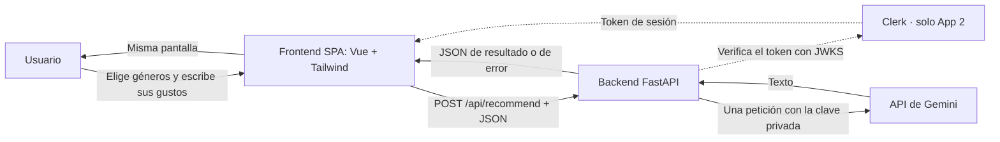

# Musicfy · Recomendador musical con IA

Práctica UD1 «Mini aplicación web con una API de IA». Curso de especialización en Aprendizaje automático: gestión de datos y entrenamiento. Módulo: Desarrollo de componentes software para sistemas de aprendizaje automático. Docente: Francisco Manuel Matías Prados.

**La necesidad:** cuando quieres descubrir música nueva parecida a la que te gusta, tienes que buscar en varias fuentes y las recomendaciones no explican por qué encajan. En Musicfy eliges géneros y describes con tus palabras lo que te gusta, y en la misma pantalla recibes entre 3 y 5 artistas recomendados, con el porqué y una canción para empezar.

Una pantalla, un formulario, una función y una API de IA. Sin bases de datos ni persistencia.

## Equipo

| Integrante | App 1 | App 2 |
|---|---|---|
| Mario Luna Lopez | Backend: FastAPI, validación, conexión con la IA y errores | Aplicación de Clerk y despliegue en AWS EC2 con Docker y HTTPS |
| Jose Antonio Nieto Perez | Frontend en Vue + Tailwind y despliegue en Vercel | Desarrollo con Spec Kit y Claude Code, integración de Clerk y despliegue en Vercel |
| David Molina Castillo | Pruebas con pytest y mocks, ERS | ERS de App 2, pruebas, `comparativa.md`, `uso-ia.md` y presentación |

El reparto completo y el registro de tiempos están en [`docs/proceso.md`](docs/proceso.md).

## Las dos aplicaciones

| | App 1 | App 2 |
|---|---|---|
| Cómo se hizo | A mano, de forma incremental | Proyecto nuevo guiado por GitHub Spec Kit con Claude Code |
| Autenticación | No | Clerk, en la misma pantalla |
| Vercel | https://proyectowebia.vercel.app/ | Frontend: https://musicfy-app2.vercel.app/ · Backend: https://musicfy-app2-api.vercel.app/ |
| AWS EC2 (Docker + HTTPS) | No se exige | https://32-200-106-42.sslip.io/ |
| Pruebas automáticas | 12 | 59 |

## Arquitectura



El frontend nunca llama a la IA: solo el backend tiene la clave. En la App 2 el backend comprueba el token de Clerk **antes** de validar la entrada y de llamar a la IA.

## Contrato de la API

`POST /api/recommend` (en la App 2, con la cabecera `Authorization: Bearer <token de Clerk>`)

```json
{"tastes": "Géneros: Rock, Indie. Además: me gusta la música de los 2000"}
```

| Código | Cuerpo | Cuándo |
|---|---|---|
| 200 | `{"resultado": "..."}` | Recomendaciones de la IA |
| 401 | `{"error": {"codigo": "NO_AUTORIZADO", ...}}` | Solo App 2: sin token, inválido o caducado |
| 422 | Error de validación | `tastes` vacío, solo espacios o con más de 500 caracteres |
| 502 | `IA_NO_DISPONIBLE` o `RESPUESTA_INVALIDA` | La IA falla o responde sin texto |
| 504 | `TIMEOUT` | La IA tarda más de 25 s |
| 500 | `ERROR_INTERNO` | Error inesperado, sin detalles internos |

`GET /health` devuelve `{"status": "ok"}`. El detalle está en las ERS y en [`app2-Musicfy/specs/001-musicfy-recomendador/contracts/api.md`](app2-Musicfy/specs/001-musicfy-recomendador/contracts/api.md).

## Tecnologías y versiones

| Capa | Tecnología |
|---|---|
| Frontend | Vue 3.5, Vite 8, Tailwind CSS 4 (App 2: `@clerk/vue` 2.x) |
| Backend | Python, FastAPI, Pydantic v2, httpx (App 2: FastAPI 0.162.0, PyJWT 2.15.1) |
| IA | API de Gemini de Google, modelo `gemini-3.5-flash-lite`, 600 tokens como máximo, timeout de 25 s |
| Pruebas | pytest con la IA (y en App 2 el verificador de Clerk) simulados |
| App 2 | GitHub Spec Kit 1.2.4.dev0 con Claude Code |
| Despliegue | Vercel (App 1 y App 2) · Docker Compose con Caddy en AWS EC2 (App 2) |

Desarrollo probado con Python 3.14 y Node 22 en Windows. Las imágenes Docker usan `python:3.12-slim` y `node:22`. Las dependencias están en `requirements.txt` y `package-lock.json`.

## Estructura del repositorio

```text
ProyectoWebIA/
├── app1-Musicfy/            App 1, hecha a mano
│   ├── backend/             main.py, ai_client.py, config.py, tests/
│   └── frontend/            Vue + Tailwind
├── app2-Musicfy/            App 2, creada vacía con Spec Kit
│   ├── .specify/            constitución del proyecto
│   ├── specs/               especificación, plan, tareas y contratos
│   ├── backend/             app/, tests/, Dockerfile
│   ├── frontend/            Vue + Clerk, Caddyfile, Dockerfile
│   └── docker-compose.yml
├── docs/                    ERS, pruebas, proceso, comparativa, despliegues, uso de IA y evidencias
├── portal/                  portal de prácticas
├── presentacion/            presentación de la defensa
└── vercel.json              despliegue de la App 1 (un proyecto con dos servicios)
```

Cambio respecto a la estructura recomendada: las carpetas se llaman `app1-Musicfy` y `app2-Musicfy`, y la configuración de Docker de la App 2 está dentro de `app2-Musicfy` (no en `infra/`), porque así la generó Spec Kit junto al resto del proyecto.

## Cómo ejecutar la App 1 en local

Necesitas tu propia clave de la API de Gemini ([Google AI Studio](https://aistudio.google.com/)).

**Backend** (en una terminal):

```powershell
cd app1-Musicfy/backend
python -m venv .venv
.\.venv\Scripts\Activate.ps1        # en Linux/macOS: source .venv/bin/activate
pip install -r requirements.txt
copy .env.example .env              # y pon tu GEMINI_API_KEY
uvicorn main:app --reload --port 8000
```

**Frontend** (en otra terminal):

```powershell
cd app1-Musicfy/frontend
npm install
copy .env.example .env
npm run dev                         # http://localhost:5173
```

## Cómo ejecutar la App 2 en local

Además de la clave de Gemini, necesitas una aplicación de Clerk (su clave publishable y su URL de emisor).

**Backend:**

```powershell
cd app2-Musicfy/backend
python -m venv .venv
.\.venv\Scripts\Activate.ps1
pip install -r requirements-dev.txt
copy .env.example .env              # GEMINI_API_KEY, CLERK_ISSUER y ALLOWED_ORIGINS
uvicorn app.main:app --reload --port 8000 --env-file .env
```

`--env-file .env` es necesario: sin él no se cargan los orígenes permitidos y CORS rechaza todas las peticiones.

**Frontend:**

```powershell
cd app2-Musicfy/frontend
npm install
copy .env.example .env              # VITE_CLERK_PUBLISHABLE_KEY y VITE_API_URL
npm run dev                         # http://localhost:5173
```

**Con Docker** (como en EC2):

```bash
cd app2-Musicfy
# backend/.env con los secretos y, en el entorno, VITE_CLERK_PUBLISHABLE_KEY y DOMINIO
docker compose build
docker compose up -d
docker compose ps
docker compose logs
docker compose down
```

## Variables de entorno

Solo se versionan los `.env.example`, con valores ficticios. Los `.env` están en `.gitignore` y en los `.dockerignore`.

| Variable | Dónde | Uso |
|---|---|---|
| `GEMINI_API_KEY` | Backend (App 1 y 2) | Clave de la API de Gemini. **Secreta.** |
| `GEMINI_URL`, `GEMINI_MODEL` | Backend | Endpoint compatible con OpenAI y modelo |
| `MAX_TOKENS`, `MAX_CARACTERES`, `AI_TIMEOUT_SECONDS` | Backend | 600 tokens, 500 caracteres y 25 s |
| `ALLOWED_ORIGINS` | Backend | Orígenes del frontend para CORS (y, en App 2, para comprobar el origen del token) |
| `CLERK_ISSUER`, `CLERK_JWKS_URL` | Backend App 2 | Emisor de Clerk y sus claves públicas |
| `VITE_API_BASE_URL`, `VITE_USE_MOCK` | Frontend App 1 | URL del backend y modo simulado |
| `VITE_CLERK_PUBLISHABLE_KEY`, `VITE_API_URL` | Frontend App 2 | Clave publishable de Clerk (pública) y URL del backend |
| `DOMINIO` | Docker Compose (EC2) | Dominio con el que Caddy obtiene el certificado HTTPS |

## Pruebas

Las pruebas automáticas no llaman a la IA real: se simula la función que la consulta, y en la App 2 también el verificador de tokens de Clerk.

```powershell
cd app1-Musicfy/backend; python -m pytest       # 12 pruebas
cd app2-Musicfy/backend; python -m pytest       # 59 pruebas
```

Casos, resultados y pruebas manuales: [`docs/pruebas.md`](docs/pruebas.md).

## Despliegues

- **App 1 en Vercel:** un único proyecto con dos servicios definidos en [`vercel.json`](vercel.json). `/api/*` va al backend, así que hay una sola URL y no hace falta CORS.
- **App 2 en Vercel:** dos proyectos (`musicfy-app2` y `musicfy-app2-api`) conectados al mismo repositorio.
- **App 2 en AWS EC2:** Docker Compose con dos contenedores: Caddy (sirve el frontend, obtiene el certificado HTTPS y reenvía `/api`) y FastAPI, que solo es accesible dentro de la red de Docker.

Pasos, variables y comprobaciones: [`docs/despliegues.md`](docs/despliegues.md).

## Documentación

| Documento | Contenido |
|---|---|
| [`docs/ERS.md`](docs/ERS.md) | Requisitos de la App 1 (versión 1.0) |
| [`docs/ERS-app2.md`](docs/ERS-app2.md) | Requisitos de la App 2, con Clerk |
| [`docs/pruebas.md`](docs/pruebas.md) | Plan y resultados de las pruebas |
| [`docs/proceso.md`](docs/proceso.md) | Reparto, tiempos, decisiones y problemas |
| [`docs/comparativa.md`](docs/comparativa.md) | Comparativa entre App 1 y App 2 |
| [`docs/despliegues.md`](docs/despliegues.md) | Vercel, Docker y EC2 |
| [`docs/uso-ia.md`](docs/uso-ia.md) | IA de la aplicación e IA usada por el equipo |
| [`app2-Musicfy/specs/`](app2-Musicfy/specs/001-musicfy-recomendador/) | Especificación, plan, tareas y contratos de Spec Kit |
| [`presentacion/`](presentacion/) | Presentación de la defensa |

## Versiones entregadas

| Etiqueta | Qué marca |
|---|---|
| `app1-final` | App 1 terminada y ERS 1.0 aprobada, antes de empezar la App 2 |
| `entrega-ud1` | Versión entregada |
