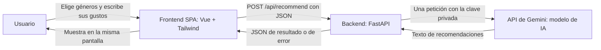
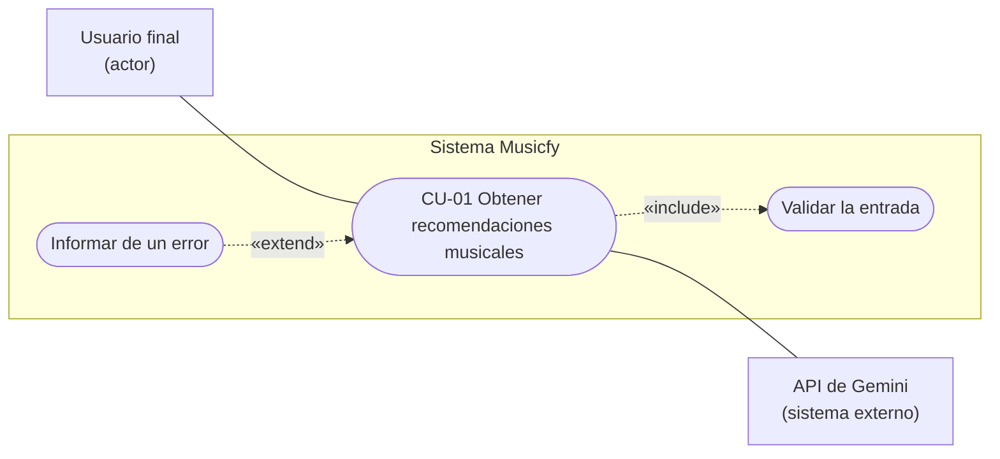
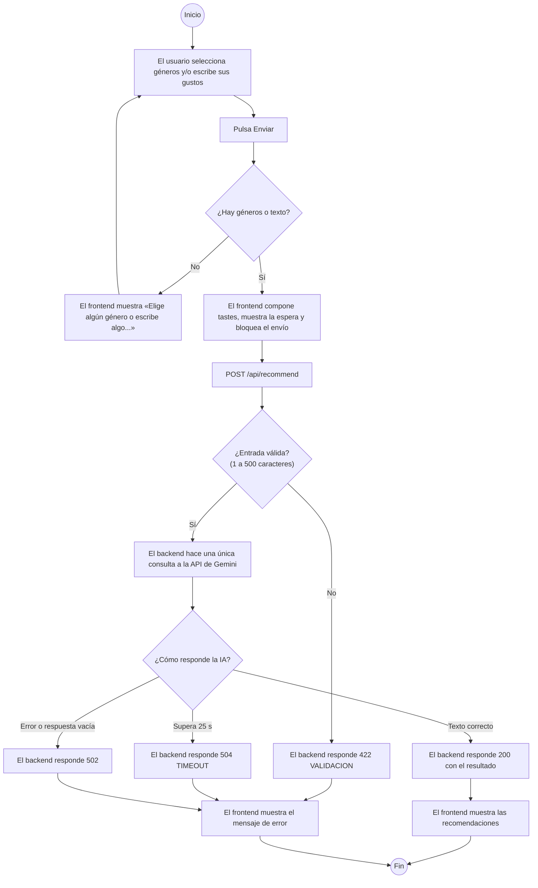
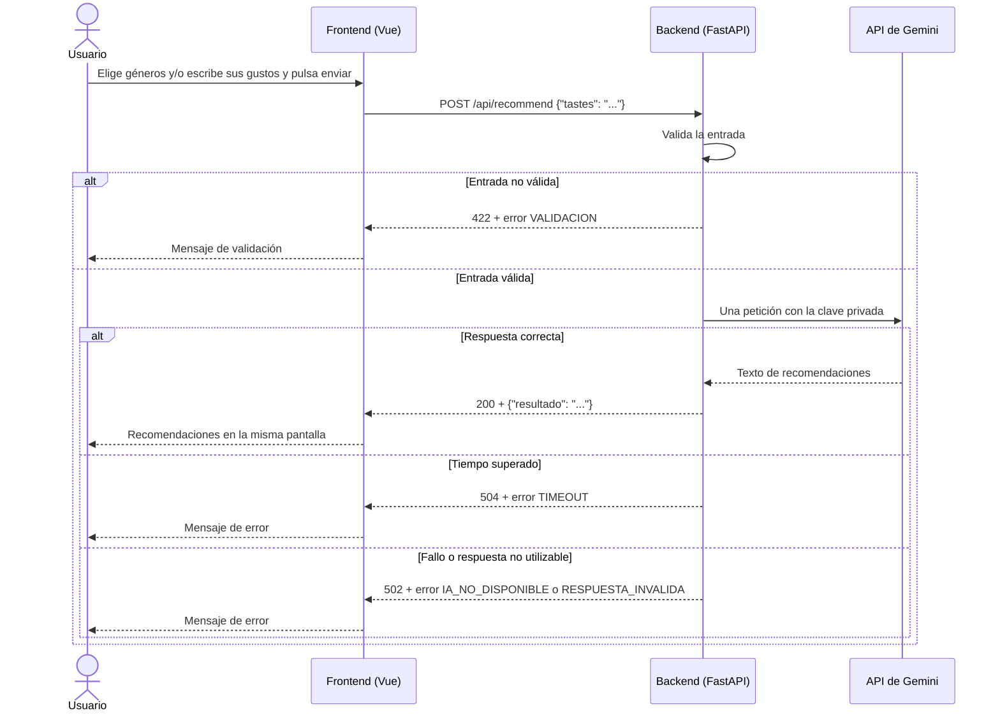

# Especificación de Requisitos del Software (ERS) — Musicfy (App 1)

## Datos del documento

| Campo | Valor |
|---|---|
| Nombre del proyecto | Musicfy — recomendador musical con inteligencia artificial (App 1) |
| Autores | Mario Luna Lopez, Jose Antonio Nieto Perez, David Molina Castillo |
| Curso y grupo | Curso de especialización en Aprendizaje automático: gestión de datos y entrenamiento |
| Asignatura o módulo | Desarrollo de componentes software para sistemas de aprendizaje automático |
| Docente | Francisco Manuel Matías Prados |
| Fecha | 19/10/2026 |
| Versión | 0.4 |
| Estado | En revisión |

### Historial de cambios

| Versión | Fecha      | Autor | Cambios realizados                                                                                                                                                                                                                                                                                                    |
| ------- | ---------- | ----- | --------------------------------------------------------------------------------------------------------------------------------------------------------------------------------------------------------------------------------------------------------------------------------------------------------------------- |
| 0.1     | 15/10/2026 | David | Primera versión del documento a partir del enunciado y de la implementación actual de App 1.                                                                                                                                                                                                                          |
| 0.2     | 15/10/2026 | David | RF-01 actualizado con la selección de géneros y el formato del texto enviado en `tastes`. DAT-01, IU-01 y RNF-04 adaptados al formulario real; RNF-04 es responsive según el criterio 1.4.10 de WCAG 2.1. Fuentes FUE-04 y FUE-05 completadas. PEN-01 y PEN-02 resueltos y PEN-05 añadido.                            |
| 0.3     | 19/10/2026 | David | RNF-04 y PR-17 ajustados a 320 px. Trazabilidad de RF-01 actualizada. CU-01 incluye los géneros y el flujo A0. Añadidos diagramas de casos de uso y de actividad. PEN-01 resuelto con el nuevo modelo. PEN-03 en curso por el despliegue inicial en Vercel.                                                           |
| 0.4     | 19/10/2026 | David | Cambio de proveedor de IA: OpenRouter se sustituye por la API de Gemini de Google (Google AI Studio). Actualizados el alcance, el glosario, las fuentes, el contexto, las restricciones, las dependencias, RF-03, RNF-01, INT-02, el caso de uso, la trazabilidad y los diagramas. PEN-01, PEN-03 y PEN-05 resueltos. |

## 1. Introducción

### 1.1. Propósito del documento

Este documento describe qué debe hacer Musicfy (App 1) y las condiciones que debe cumplir. Lo utilizan:

- **El equipo de desarrollo**, para acordar el alcance, el contrato entre frontend y backend y los criterios con los que se considera terminado cada requisito.
- **El docente**, para revisar que la aplicación respeta el alcance obligatorio de la práctica y que cada requisito tiene una forma objetiva de comprobarse.

Permite revisar decisiones como los límites de entrada, el comportamiento ante errores del proveedor de IA y la ausencia de persistencia de datos.

### 1.2. Problema y objetivos

**Problema o necesidad:** cuando una persona quiere descubrir música nueva parecida a la que le gusta, suele tener que buscar en varias fuentes, leer listas genéricas o depender de recomendaciones automáticas que no explican por qué encajan. Musicfy permite describir con palabras propias los gustos o el tipo de música buscado y recibir en una sola pantalla unas pocas recomendaciones explicadas.

**Usuario y uso:** cualquier persona que quiera descubrir artistas nuevos escribe qué música le gusta o qué le apetece escuchar y recibe recomendaciones justificadas para empezar a escuchar.

| ID | Objetivo del proyecto | Indicador de logro |
|---|---|---|
| OBJ-01 | Ofrecer recomendaciones musicales a partir de una descripción libre de los gustos del usuario. | Con una entrada válida, la aplicación muestra en la misma pantalla un texto de recomendaciones devuelto por la IA (demostración PR-13). |
| OBJ-02 | Rechazar entradas no válidas sin consultar a la IA. | Las pruebas automáticas de validación pasan y comprueban que no se realiza ninguna llamada a la IA (PR-02 a PR-06). |
| OBJ-03 | Informar al usuario de forma comprensible cuando la IA falla o tarda demasiado. | Las pruebas de error devuelven 502 o 504 con el formato de error acordado (PR-10 a PR-12). |
| OBJ-04 | Mantener la clave del proveedor de IA fuera del frontend y del repositorio. | La inspección PR-14 no encuentra la clave en el código del frontend, en el repositorio ni en su historial. |

### 1.3. Alcance

**El sistema incluirá:**

- Una única pantalla con un único formulario para describir los gustos musicales, mediante la selección de géneros y un texto libre.
- La validación de la entrada en el backend.
- Una única consulta a una única API de IA (API de Gemini de Google) por cada envío válido.
- La presentación del resultado, o del error correspondiente, en la misma pantalla.

**Queda fuera del alcance:**

- Bases de datos de cualquier tipo y cualquier persistencia de entradas o resultados, incluido `localStorage`, `sessionStorage` o IndexedDB.
- Historial de consultas, favoritos, listas de reproducción o conversaciones con memoria.
- Registro, inicio de sesión, perfiles o cualquier gestión de usuarios (la autenticación con Clerk corresponde a la App 2 y se especifica aparte).
- Reproducción de música, enlaces a plataformas de streaming o búsquedas en otras APIs.
- Varias pantallas, rutas de navegación, paneles de administración o estadísticas.
- Subida de archivos, pagos, correo, colas o procesos en segundo plano.

### 1.4. Definiciones y abreviaturas

| Término           | Definición                                                                                                                                                            |
| ----------------- | --------------------------------------------------------------------------------------------------------------------------------------------------------------------- |
| ERS               | Especificación de Requisitos del Software.                                                                                                                            |
| SPA               | *Single Page Application*: aplicación web de una sola página que se actualiza sin recargar.                                                                           |
| API               | Interfaz que permite a un programa comunicarse con otro mediante peticiones.                                                                                          |
| Endpoint          | Dirección concreta del backend que atiende un tipo de petición, por ejemplo `POST /api/recommend`.                                                                    |
| JSON              | Formato de texto para intercambiar datos estructurados.                                                                                                               |
| LLM               | Modelo de lenguaje de gran tamaño que genera texto, en este caso las recomendaciones.                                                                                 |
| API de Gemini     | Servicio de Google (Google AI Studio) que da acceso a los modelos Gemini con una clave de API. El backend usa su punto de acceso compatible con el formato de OpenAI. |
| Token             | Unidad en la que el proveedor de IA mide el texto procesado y su coste.                                                                                               |
| Gustos (`tastes`) | Texto libre en el que el usuario describe artistas, géneros, épocas o sensaciones que le gustan.                                                                      |
| Mock              | Sustituto controlado de un componente real que se usa en las pruebas automáticas para no llamar a la IA real.                                                         |
| CORS              | Mecanismo del navegador que controla qué páginas web pueden llamar al backend.                                                                                        |
| API de Gemini     | Servicio de Google (Google AI Studio) que da acceso a los modelos Gemini con una clave de API. El backend usa su punto de acceso compatible con el formato de OpenAI. |
### 1.5. Referencias y fuentes

| ID | Fuente | Fecha o versión | Ubicación |
|---|---|---|---|
| FUE-01 | Enunciado de la práctica «UD1 · Mini aplicación web con una API de IA» | Documentación técnica consultada el 06/10/2026 | Facilitado por el docente |
| FUE-02 | Plantilla `plantillaERS.md` | Versión facilitada por el docente | Facilitada por el docente |
| FUE-03 | Decisiones del equipo (proveedor de IA, límites y contrato) | Octubre de 2026 | `docs/uso-ia.md` |
| FUE-04 | Documentación oficial de FastAPI | 0.115.0 | https://fastapi.tiangolo.com |
| FUE-05 | Documentación oficial de la API de Gemini | Consultada el 19/10/2026 | https://ai.google.dev/gemini-api/docs |

## 2. Descripción general del sistema

### 2.1. Contexto y perspectiva del producto

Musicfy es un sistema nuevo. Se usa desde un navegador web y se compone de:

- Un **frontend** SPA en Vue.js con Tailwind CSS, que muestra el formulario y el resultado.
- Un **backend** en Python con FastAPI, que valida la entrada, consulta a la IA y devuelve JSON.
- Un **proveedor de IA externo**, la API de Gemini de Google, al que el backend envía una única petición por consulta.

El frontend nunca se comunica directamente con la IA: todas las peticiones pasan por el backend, que es el único que conoce la clave.

Diagrama de arquitectura y contexto (aclara qué componentes existen y por dónde circulan los datos):

### 2.2. Personas interesadas y tipos de usuario

| ID | Persona, colectivo o rol | Necesidad o responsabilidad | Permisos y conocimientos relevantes |
|---|---|---|---|
| ACT-01 | Usuario final | Descubrir música nueva a partir de sus gustos. | Usa la única pantalla sin identificarse. No necesita conocimientos técnicos. |
| ACT-02 | Equipo de desarrollo | Construir, probar, desplegar y documentar la aplicación. | Acceso al repositorio y a la configuración privada del backend. |
| ACT-03 | Docente | Revisar el cumplimiento del enunciado y evaluar la práctica. | Acceso al repositorio, la documentación y las URL desplegadas. |

No existe un rol de administrador funcional dentro de la aplicación.

### 2.3. Funciones principales

Musicfy ofrece una única función útil, compuesta por tres partes:

- **Introducir** los gustos musicales en el formulario: seleccionar géneros y describir con texto libre el estado de ánimo, los artistas u otras preferencias.
- **Procesar** la descripción: validarla y obtener recomendaciones mediante una consulta a la IA.
- **Mostrar** las recomendaciones, o un mensaje de error comprensible, en la misma pantalla.

### 2.4. Entorno de uso

| Aspecto | Descripción |
|---|---|
| Dispositivos y plataformas | Probado en navegadores de escritorio (Chrome y Firefox) y en la vista de móvil de sus herramientas de desarrollo. |
| Condiciones de uso | Requiere conexión a internet. Uso puntual: una consulta cada vez. |
| Volumen esperado | Volumen de demostración académica: consultas manuales del equipo y del docente. No se establecen cifras de capacidad porque no se han medido. |

### 2.5. Restricciones

| ID | Restricción | Origen o justificación |
|---|---|---|
| RES-01 | Backend en Python con FastAPI. | Obligatorio (FUE-01). |
| RES-02 | Frontend como SPA en Vue.js con Tailwind CSS. | Obligatorio elegir Vue o React y usar Tailwind (FUE-01). Vue es elección del equipo. |
| RES-03 | Una sola pantalla, un solo formulario, una sola función y una sola API de IA. | Regla obligatoria de simplicidad (FUE-01). |
| RES-04 | Sin bases de datos ni persistencia de entradas o resultados. | Prohibición expresa (FUE-01). |
| RES-05 | La clave del proveedor de IA solo puede estar en el backend, en variables de entorno. | Seguridad (FUE-01). |
| RES-06 | Pruebas automáticas con pytest y la IA simulada mediante mocks. | Obligatorio (FUE-01). |
| RES-07 | Despliegue de frontend y backend en Vercel. | Obligatorio (FUE-01). |
| RES-08 | Uso del plan gratuito de la API de Gemini, con límites de peticiones; cada petición limita la respuesta a un máximo de tokens. | Presupuesto disponible del equipo (FUE-03). |
| RES-09 | Equipo de tres personas y plazo fijado por el docente. | Organización de la práctica (FUE-01). |

### 2.6. Suposiciones y dependencias

| ID | Tipo | Descripción | Consecuencia si no se cumple |
|---|---|---|---|
| DEP-01 | Dependencia | Servicio de la API de Gemini disponible y modelo configurado accesible. | La aplicación no puede generar recomendaciones y muestra el error 502 o 504 controlado. |
| DEP-02 | Dependencia | Cuota del plan gratuito de la API de Gemini no agotada. | La API rechaza la petición y la aplicación muestra el error 502 controlado. |
| DEP-03 | Dependencia | Cuentas de Vercel disponibles para el despliegue. | Sin ellas no puede publicarse la aplicación. Cumplida: ver PEN-03. |
| SUP-01 | Suposición | El modelo de IA sigue las instrucciones del prompt (responder en español con entre 3 y 5 recomendaciones). | El texto puede variar en número o formato. El backend solo garantiza que el resultado no esté vacío; el contenido no se promete exacto. |

## 3. Requisitos funcionales

**Prioridades:** Alta = imprescindible para la versión prevista; Media = importante, pero puede aplazarse mediante acuerdo; Baja = deseable.

### 3.1. Catálogo de requisitos funcionales

| ID | Nombre | Prioridad | Fuente | Estado |
|---|---|---|---|---|
| RF-01 | Introducir los gustos musicales | Alta | FUE-01 | Validado |
| RF-02 | Validar la entrada | Alta | FUE-01 | Validado |
| RF-03 | Obtener recomendaciones de la IA | Alta | FUE-01 | Validado |
| RF-04 | Mostrar el resultado en la misma pantalla | Alta | FUE-01 | Validado |
| RF-05 | Informar de los errores del proveedor de IA | Alta | FUE-01 | Validado |

### 3.2. Fichas de requisitos funcionales

#### RF-01. Introducir los gustos musicales

| Campo | Descripción |
|---|---|
| Enunciado | El sistema deberá ofrecer un formulario en el que el usuario seleccione géneros musicales y describa con texto libre sus preferencias, y un botón para enviarlo. |
| Justificación | Es la única entrada de datos de la aplicación. Los géneros facilitan la descripción y el texto permite concretar estado de ánimo, artistas u otras preferencias. |
| Actor | ACT-01 Usuario final |
| Prioridad | Alta |
| Fuente | FUE-01, FUE-03 |
| Precondiciones | La pantalla de Musicfy está cargada. |
| Entradas | Géneros seleccionados (opcionales, uno o varios) y texto libre (opcional). |
| Comportamiento esperado | El frontend compone un único texto con el formato `Géneros: <lista>. Además: <texto libre>` y lo envía en el campo `tastes` de una petición `POST /api/recommend`. |
| Salidas y postcondiciones | La petición queda enviada y la pantalla pasa al estado de espera. |
| Errores o alternativas | Mientras hay una petición pendiente, el formulario no permite un segundo envío. Si no se ha seleccionado ningún género ni escrito texto, el frontend no envía la petición y muestra el mensaje «Elige algún género o escribe algo sobre la música que te gusta». Si se recibiera una petición vacía por otra vía, el backend la rechaza con 422 (RF-02). El texto compuesto, incluidos los géneros, está sujeto al límite de 500 caracteres. |
| Dependencias | RF-02, RF-03 |

**Criterios de aceptación:**

- **CA-RF01-01:** Dado que el usuario ha seleccionado géneros y escrito un texto, cuando pulsa enviar, entonces se envía una única petición al backend cuyo campo `tastes` contiene los géneros seleccionados y el texto escrito.
- **CA-RF01-02:** Dado que el usuario solo ha seleccionado géneros, cuando pulsa enviar, entonces se envía una petición cuyo campo `tastes` contiene esos géneros.
- **CA-RF01-03:** Dado que hay una petición en curso, cuando el usuario vuelve a pulsar enviar, entonces no se envía una segunda petición.
- **CA-RF01-04:** Dado que el usuario no ha seleccionado géneros ni escrito texto, cuando intenta enviar, entonces el frontend muestra el mensaje «Elige algún género o escribe algo sobre la música que te gusta» y no se envía ninguna petición al backend.

#### RF-02. Validar la entrada

| Campo | Descripción |
|---|---|
| Enunciado | El sistema deberá rechazar en el backend las peticiones cuyo campo `tastes` falte, esté vacío, contenga solo espacios o supere los 500 caracteres tras eliminar los espacios iniciales y finales. |
| Justificación | Evitar consultas inútiles o abusivas a la IA y proteger el saldo. |
| Actor | Backend |
| Prioridad | Alta |
| Fuente | FUE-01 |
| Precondiciones | Llega una petición a `POST /api/recommend`. |
| Entradas | Campo `tastes`: texto obligatorio, entre 1 y 500 caracteres tras eliminar espacios iniciales y finales. El límite es configurable con `MAX_CARACTERES`. |
| Comportamiento esperado | Si la entrada es válida, elimina los espacios iniciales y finales y continúa con RF-03. Si no lo es, responde sin consultar a la IA. |
| Salidas y postcondiciones | Entrada no válida: código 422 con `{"error": {"codigo": "VALIDACION", "mensaje": "..."}}`. |
| Errores o alternativas | La validación del frontend ayuda al usuario pero no sustituye a la del backend. |
| Dependencias | RF-03 |

**Criterios de aceptación:**

- **CA-RF02-01:** Dado un texto vacío, cuando se envía, entonces el backend responde 422 con el código `VALIDACION` y no llama a la IA.
- **CA-RF02-02:** Dado un texto formado solo por espacios, cuando se envía, entonces el backend responde 422.
- **CA-RF02-03:** Dada una petición sin el campo `tastes`, cuando se envía, entonces el backend responde 422.
- **CA-RF02-04:** Dado un texto de exactamente 500 caracteres, cuando se envía, entonces se acepta.
- **CA-RF02-05:** Dado un texto de 501 caracteres, cuando se envía, entonces el backend responde 422.

#### RF-03. Obtener recomendaciones de la IA

| Campo | Descripción |
|---|---|
| Enunciado | El sistema deberá realizar exactamente una consulta a la API de Gemini por cada envío válido, con el texto validado del usuario, y devolver el texto obtenido en formato JSON. |
| Justificación | Es la función principal de la aplicación. |
| Actor | Backend |
| Prioridad | Alta |
| Fuente | FUE-01 |
| Precondiciones | La entrada ha superado RF-02. La clave y el modelo están configurados en el backend. |
| Entradas | Texto validado (`tastes`). |
| Comportamiento esperado | Envía a la API de Gemini las instrucciones del recomendador y el texto del usuario, con un máximo de tokens de respuesta y un tiempo máximo de espera. Comprueba que la respuesta contiene texto. |
| Salidas y postcondiciones | Código 200 con `{"resultado": "texto de las recomendaciones"}`. No se conserva nada tras la respuesta. |
| Errores o alternativas | Ver RF-05. |
| Dependencias | RF-02, RF-05, DEP-01, DEP-02 |

**Criterios de aceptación:**

- **CA-RF03-01:** Dado un texto válido y una IA simulada que responde correctamente, cuando se envía, entonces el backend responde 200 con el resultado de la IA y la IA se ha llamado una sola vez con el texto del usuario.
- **CA-RF03-02:** Dado un texto válido con espacios al principio y al final, cuando se envía, entonces la IA recibe el texto sin esos espacios.

#### RF-04. Mostrar el resultado en la misma pantalla

| Campo | Descripción |
|---|---|
| Enunciado | El sistema deberá mostrar el resultado o el mensaje de error en la misma pantalla del formulario, como texto plano y sustituyendo cualquier resultado anterior. |
| Justificación | Regla de una sola pantalla y seguridad ante contenido generado por la IA. |
| Actor | ACT-01 Usuario final |
| Prioridad | Alta |
| Fuente | FUE-01 |
| Precondiciones | El backend ha respondido. |
| Entradas | JSON de resultado o de error. |
| Comportamiento esperado | Mientras espera, muestra un indicador de carga. Al recibir la respuesta, muestra el texto del resultado o el mensaje de error. No interpreta HTML ni ejecuta código devuelto por la IA. |
| Salidas y postcondiciones | El usuario ve el resultado o el error. No se acumulan resultados anteriores ni se guardan. |
| Errores o alternativas | Un texto de respuesta largo no debe romper el diseño. |
| Dependencias | RF-03, RF-05 |

**Criterios de aceptación:**

- **CA-RF04-01:** Dado un envío válido, cuando el backend responde 200, entonces el texto aparece en la misma pantalla, sin navegar a otra.
- **CA-RF04-02:** Dado un resultado previo en pantalla, cuando se hace una nueva consulta, entonces solo se muestra el nuevo resultado.
- **CA-RF04-03:** Dada una respuesta que contiene etiquetas HTML, cuando se muestra, entonces aparecen como texto y no se interpretan.

#### RF-05. Informar de los errores del proveedor de IA

| Campo | Descripción |
|---|---|
| Enunciado | El sistema deberá devolver un error controlado, sin detalles internos, cuando la IA no responda a tiempo, falle o devuelva una respuesta sin contenido utilizable. |
| Justificación | El usuario debe entender qué ha pasado y no deben exponerse datos internos ni secretos. |
| Actor | Backend y frontend |
| Prioridad | Alta |
| Fuente | FUE-01 |
| Precondiciones | La entrada es válida y se ha consultado a la IA. |
| Entradas | Respuesta o fallo del proveedor de IA. |
| Comportamiento esperado | Convierte cada situación en el código y el mensaje acordados. El frontend muestra el mensaje en la misma pantalla. |
| Salidas y postcondiciones | Tiempo de espera superado: 504 con código `TIMEOUT`. Fallo de conexión o respuesta de error del proveedor: 502 con código `IA_NO_DISPONIBLE`. Respuesta sin texto utilizable: 502 con código `RESPUESTA_INVALIDA`. Error inesperado: 500 con código `ERROR_INTERNO`. |
| Errores o alternativas | Las respuestas de error nunca incluyen trazas de error, la clave ni la respuesta completa del proveedor. |
| Dependencias | RF-03, DEP-01, DEP-02 |

**Criterios de aceptación:**

- **CA-RF05-01:** Dada una IA simulada que supera el tiempo máximo, cuando se envía un texto válido, entonces el backend responde 504 con el código `TIMEOUT`.
- **CA-RF05-02:** Dada una IA simulada que falla, cuando se envía un texto válido, entonces el backend responde 502 con el código `IA_NO_DISPONIBLE`.
- **CA-RF05-03:** Dada una IA simulada que devuelve una respuesta sin contenido utilizable, cuando se envía un texto válido, entonces el backend responde 502 con el código `RESPUESTA_INVALIDA`.

## 4. Requisitos no funcionales

| ID | Categoría | Requisito medible | Condiciones de comprobación | Criterio de aceptación | Prioridad |
|---|---|---|---|---|---|
| RNF-01 | Seguridad | La clave de la API de Gemini solo existe en la configuración privada del backend. | Revisar el código del frontend, el paquete compilado del frontend, el repositorio y su historial. | La clave no aparece en ninguno de ellos. `.env` está excluido en `.gitignore` y solo se versiona `.env.example` con valores ficticios. | Alta |
| RNF-02 | Fiabilidad | Si la IA no responde en 25 segundos (configurable con `AI_TIMEOUT_SECONDS`), el backend deja de esperar y devuelve el error acordado. | Prueba automática con la IA simulada lanzando el error de tiempo superado. | Respuesta 504 con `{"error": {"codigo": "TIMEOUT", ...}}`, sin traza de error ni detalles internos. | Alta |
| RNF-03 | Privacidad | El sistema no conserva las entradas ni los resultados después de responder. | Inspección del código (sin bases de datos, archivos ni almacenamiento del navegador para estos datos) y reinicio del backend y recarga del frontend. | Tras el reinicio y la recarga no aparece ninguna consulta ni resultado anterior. | Alta |
| RNF-04 | Usabilidad y accesibilidad | El formulario, incluidos los botones de género, se puede usar con teclado y en pantallas de móvil. | Navegador de escritorio y vista de 320 px de ancho. | El campo de texto tiene etiqueta visible asociada; el grupo de géneros tiene un nombre accesible; se llega a cada género, al campo y al botón con el tabulador, con foco visible; el estado seleccionado de un género se distingue sin depender solo del color; y la página no tiene desplazamiento horizontal a 320 px. | Media |

## 5. Datos y reglas de negocio

### 5.1. Información que gestionará el sistema

Todos los datos son **transitorios**: existen en memoria solo mientras se procesa y se muestra cada consulta.

| ID | Entidad o conjunto de datos | Campos principales | Validaciones | Acceso y conservación |
|---|---|---|---|---|
| DAT-01 | Petición de recomendación | `tastes`: texto compuesto por el frontend con el formato `Géneros: <lista>. Además: <texto libre>`; puede faltar cualquiera de las dos partes, pero no ambas. | Obligatorio; entre 1 y 500 caracteres tras eliminar espacios iniciales y finales, incluidos los géneros. | Lo envía el frontend al backend y el backend a la IA. No se conserva. |
| DAT-02 | Respuesta de recomendación | `resultado`: texto | No vacío. | La genera la IA y la devuelve el backend al frontend. No se conserva. |
| DAT-03 | Respuesta de error | `error.codigo`: texto; `error.mensaje`: texto | `codigo` es uno de `VALIDACION`, `TIMEOUT`, `IA_NO_DISPONIBLE`, `RESPUESTA_INVALIDA` o `ERROR_INTERNO`. | La devuelve el backend al frontend. No se conserva. |

### 5.2. Reglas de negocio

No aplica: la aplicación no tiene condiciones propias del ámbito del problema que el sistema deba hacer cumplir. Las condiciones existentes son validaciones técnicas de la entrada (RF-02). El número de recomendaciones y su formato son instrucciones al modelo de IA (SUP-01) y no se garantizan.

## 6. Interfaces externas

### 6.1. Interfaz de usuario

| ID | Pantalla o interacción | Usuarios | Información y acciones necesarias | Requisitos relacionados |
|---|---|---|---|---|
| IU-01 | Pantalla única de Musicfy | ACT-01 | Título de la aplicación; grupo de botones de género de selección múltiple, con el estado de cada uno visible; campo de texto etiquetado para concretar los gustos; botón de envío; mensaje de validación cuando no hay géneros ni texto; indicador de espera; zona de resultado; zona de mensaje de error. | RF-01, RF-04, RF-05, RNF-04 |

La pantalla tiene cuatro estados: **entrada** (formulario listo), **espera** (petición en curso y envío bloqueado), **resultado** (recomendaciones visibles) y **error** (mensaje comprensible).

### 6.2. Interfaces con otros sistemas o dispositivos

| ID | Sistema o dispositivo externo | Información intercambiada | Dirección y momento del intercambio | Formato o protocolo exigido | Respuesta ante fallos |
|---|---|---|---|---|---|
| INT-01 | Backend de Musicfy (desde el frontend) | Envío: `{"tastes": "..."}`. Respuesta: `{"resultado": "..."}` o `{"error": {"codigo": "...", "mensaje": "..."}}`. | Ambas, en cada envío del formulario. | HTTP `POST /api/recommend` con JSON. Códigos: 200, 422, 500, 502 y 504. | El frontend muestra el mensaje de error recibido en la misma pantalla. |
| INT-02 | API de Gemini de Google (desde el backend) | Envío: modelo, instrucciones del recomendador, texto del usuario y máximo de tokens. Respuesta: texto generado. | Ambas, una vez por envío válido. | HTTPS con JSON en el formato compatible con OpenAI. Clave en la cabecera `Authorization`, leída de la variable de entorno `GEMINI_API_KEY`. Dirección configurable con `GEMINI_URL`, modelo con `GEMINI_MODEL` y máximo de tokens con `MAX_TOKENS`. | Tiempo superado: 504. Error del proveedor o de conexión: 502. Respuesta sin texto: 502. |
| INT-03 | Comprobación de estado (técnica) | Respuesta: `{"status": "ok", ...}` | Salida, cuando se consulta. | HTTP `GET /health`. | No aplica: es un endpoint técnico sin interfaz de usuario. |

## 7. Casos de uso o escenarios de usuario

Diagrama de casos de uso (notación UML adaptada a Mermaid). Muestra quién interactúa con el sistema y qué puede hacer: un solo actor humano, un único caso de uso principal y el proveedor de IA como sistema externo.

### CU-01. Obtener recomendaciones musicales

| Campo | Descripción |
|---|---|
| Objetivo | Recibir recomendaciones de música a partir de una descripción de los gustos. |
| Actor principal | ACT-01 Usuario final |
| Precondiciones | La pantalla de Musicfy está cargada y el backend está disponible. |
| Evento de inicio | El usuario selecciona géneros y/o escribe sus gustos y pulsa enviar. |
| Requisitos relacionados | RF-01, RF-02, RF-03, RF-04, RF-05, RNF-01, RNF-02, RNF-03 |

**Flujo principal:**

1. El usuario selecciona géneros y/o escribe sus gustos musicales y pulsa enviar.
2. El frontend muestra el estado de espera, bloquea un nuevo envío y envía la petición al backend.
3. El backend valida la entrada.
4. El backend realiza una única consulta a la API de Gemini.
5. La API de Gemini devuelve el texto de recomendaciones.
6. El backend devuelve 200 con el resultado.
7. El frontend muestra el resultado en la misma pantalla.

**Flujos alternativos y excepciones:**

- **A0 — Formulario vacío:** en el paso 1, si no hay géneros seleccionados ni texto, el frontend muestra «Elige algún género o escribe algo sobre la música que te gusta», no envía la petición y el flujo vuelve al paso 1.
- **A1 — Entrada no válida:** en el paso 3, si el texto falta, está vacío, solo tiene espacios o supera 500 caracteres, el backend responde 422 sin consultar a la IA, el frontend muestra el mensaje de validación y el flujo termina.
- **A2 — La IA tarda demasiado:** en el paso 4, si no hay respuesta en 25 segundos, el backend responde 504, el frontend muestra el mensaje de error y el flujo termina.
- **A3 — La IA falla:** en el paso 4, si hay un error de conexión o el proveedor responde con un error, el backend responde 502 con `IA_NO_DISPONIBLE`, el frontend muestra el mensaje y el flujo termina.
- **A4 — Respuesta no utilizable:** en el paso 5, si la respuesta no contiene texto, el backend responde 502 con `RESPUESTA_INVALIDA`, el frontend muestra el mensaje y el flujo termina.

**Postcondiciones:** el usuario ve el resultado o un mensaje de error. En ningún caso se guarda la entrada ni el resultado.

Diagrama de actividad (notación UML adaptada a Mermaid). Muestra el recorrido completo de una consulta, con todas las decisiones y caminos de error, tanto en el frontend como en el backend.

## 8. Verificación y trazabilidad

Las pruebas automáticas están en `backend/tests/test_api.py` y se ejecutan con `python -m pytest`. Usan una IA simulada y no consultan la API de IA real. Los resultados de las pruebas automáticas y manuales se registran en `docs/pruebas.md`.

| Requisito | Objetivo o necesidad de origen | Criterio de aceptación             | ID de prueba | Método y datos de comprobación                                                                                                                     | Resultado esperado                                                                                        |
| --------- | ------------------------------ | ---------------------------------- | ------------ | -------------------------------------------------------------------------------------------------------------------------------------------------- | --------------------------------------------------------------------------------------------------------- |
| RF-01     | OBJ-01                         | CA-RF01-01 a CA-RF01-04            | PR-16        | Demostración manual con F12 abierto: enviar géneros y texto, solo géneros, nada, y pulsar enviar varias veces durante la espera.                   | `tastes` contiene lo seleccionado y escrito; una sola petición; mensaje de validación cuando no hay nada. |
| RF-02     | OBJ-02                         | CA-RF02-01                         | PR-02, PR-08 | `test_texto_vacio_da_422`, `test_texto_vacio_no_llama_a_la_ia`                                                                                     | 422 con `VALIDACION`; la IA simulada no se llama.                                                         |
| RF-02     | OBJ-02                         | CA-RF02-02                         | PR-03        | `test_texto_solo_espacios_da_422`                                                                                                                  | 422.                                                                                                      |
| RF-02     | OBJ-02                         | CA-RF02-03                         | PR-04        | `test_sin_campo_tastes_da_422`                                                                                                                     | 422.                                                                                                      |
| RF-02     | OBJ-02                         | CA-RF02-04                         | PR-07        | `test_texto_justo_en_el_limite_funciona` (500 caracteres)                                                                                          | 200.                                                                                                      |
| RF-02     | OBJ-02                         | CA-RF02-05                         | PR-05        | `test_texto_demasiado_largo_da_422` (501 caracteres)                                                                                               | 422.                                                                                                      |
| RF-03     | OBJ-01                         | CA-RF03-01                         | PR-06        | `test_texto_valido_devuelve_recomendacion`                                                                                                         | 200 con el resultado simulado; una única llamada a la IA con el texto del usuario.                        |
| RF-03     | OBJ-01                         | CA-RF03-02                         | PR-09        | `test_se_quitan_espacios_antes_de_llamar_a_la_ia`                                                                                                  | La IA simulada recibe el texto sin espacios iniciales ni finales.                                         |
| RF-03     | OBJ-01                         | CA-RF03-01                         | PR-13        | Prueba manual de integración con la API de Gemini real y datos ficticios, en local y en el despliegue, documentada con fecha en `docs/pruebas.md`. | 200 con un texto de recomendaciones no vacío.                                                             |
| RF-04     | OBJ-01                         | CA-RF04-01, CA-RF04-02, CA-RF04-03 | PR-16        | Demostración manual en la pantalla: dos consultas seguidas y una respuesta con etiquetas HTML.                                                     | Resultado en la misma pantalla, sin acumular, y HTML mostrado como texto.                                 |
| RF-05     | OBJ-03                         | CA-RF05-01                         | PR-10        | `test_ia_tarda_demasiado_da_504`                                                                                                                   | 504 con `TIMEOUT`.                                                                                        |
| RF-05     | OBJ-03                         | CA-RF05-02                         | PR-11        | `test_ia_falla_da_502`                                                                                                                             | 502 con `IA_NO_DISPONIBLE`.                                                                               |
| RF-05     | OBJ-03                         | CA-RF05-03                         | PR-12        | `test_ia_responde_algo_roto_da_502`                                                                                                                | 502 con `RESPUESTA_INVALIDA`.                                                                             |
| RNF-01    | OBJ-04                         | Sección 4                          | PR-14        | Inspección del frontend, del paquete compilado, del repositorio y de su historial.                                                                 | La clave no aparece.                                                                                      |
| RNF-02    | OBJ-03                         | Sección 4                          | PR-10        | `test_ia_tarda_demasiado_da_504`                                                                                                                   | 504 con `TIMEOUT` y sin detalles internos.                                                                |
| RNF-03    | RES-04                         | Sección 4                          | PR-15        | Inspección del código y reinicio del backend y recarga del frontend.                                                                               | No aparece ninguna consulta ni resultado anterior.                                                        |
| RNF-04    | OBJ-01                         | Sección 4                          | PR-17        | Recorrido con teclado y vista de 320 px en el navegador.                                                                                           | Etiqueta visible, foco visible, estado de los géneros no solo por color y sin desplazamiento horizontal.  |

La prueba técnica PR-01 (`test_health_responde_ok`) comprueba que el backend responde en `GET /health` (INT-03).

## 9. Cuestiones pendientes

| ID     | Duda o decisión pendiente                                                                                                         | Requisitos afectados | Responsable de resolverla | Fecha prevista | Resolución                                                                                                                                                                                                                                |
| ------ | --------------------------------------------------------------------------------------------------------------------------------- | -------------------- | ------------------------- | -------------- | ----------------------------------------------------------------------------------------------------------------------------------------------------------------------------------------------------------------------------------------- |
| PEN-01 | Confirmar el proveedor y el modelo definitivos de IA y documentarlos en `docs/uso-ia.md`.                                         | RF-03, INT-02        | José Antonio Nieto Pérez  | 15/10/2026     | Resuelto 19/10/2026: se sustituye OpenRouter por la API de Gemini de Google con el modelo `gemini-3.5-flash-lite`, configurado en `.env.example` y documentado en `docs/uso-ia.md`. Comprobado con una petición real (PR-13).             |
| PEN-02 | Verificar en el frontend la validación sin datos, el bloqueo de envíos duplicados y que el resultado se muestra como texto plano. | RF-01, RF-04         | José Antonio Nieto Pérez  | 15/10/2026     | Resuelto 15/10/2026: sin géneros ni texto no se envía la petición; no permite envíos duplicados; el resultado se muestra como texto plano.                                                                                                |
| PEN-03 | Confirmar las cuentas de Vercel y las URL de despliegue.                                                                          | RES-07, DEP-03       | José Antonio Nieto Pérez  | 15/10/2026     | Resuelto 19/10/2026: frontend y backend desplegados en Vercel y funcionando, con un caso válido y uno de error probados desde la URL pública. Frontend: [https://proyectowebia.vercel.app/]. Backend: [https://proyectowebia.vercel.app/api/recommend]. Detalle en `docs/despliegues.md`. |
| PEN-04 | Revisión cruzada de esta ERS por los tres integrantes.                                                                            | Todos                | Equipo                    | 19/10/2026     | Pendiente                                                                                                                                                                                                                                 |
| PEN-05 | Decidir si se añade saldo a la cuenta de OpenRouter o se cambia a un modelo gratuito antes de la demostración.                    | RF-03, DEP-02        | José Antonio Nieto Pérez  | 19/10/2026     | Resuelto 19/10/2026: se sustituye OpenRouter por el plan gratuito de la API de Gemini (ver PEN-01)                                                                                                                                        |

## 10. Revisión y conformidad

### 10.1. Lista de comprobación antes de entregar

- [x] El problema, los objetivos y los límites del sistema están definidos.
- [x] Se identifican los usuarios y sus permisos.
- [x] Cada requisito tiene un identificador único.
- [x] Los requisitos son claros, necesarios y no se contradicen.
- [x] Cada requisito funcional expresa una obligación y tiene criterios de aceptación verificables.
- [x] Se contemplan los errores y los casos límite relevantes.
- [x] Los requisitos no funcionales incluyen medidas y condiciones de comprobación.
- [x] Los datos, las reglas de negocio y las interfaces están descritos.
- [x] Todos los requisitos están relacionados con su origen y su comprobación.
- [x] Las dudas pendientes están identificadas y tienen un responsable.
- [ ] Se han sustituido los marcadores, eliminado los ejemplos y justificado los apartados que no aplican.
- [x] Se han actualizado la fecha, la versión y el historial de cambios.

### 10.2. Registro de revisión

| Revisor y rol            | Versión revisada | Fecha      | Resultado | Observaciones     |
| ------------------------ | ---------------- | ---------- | --------- | ----------------- |
| Mario Luna Lopez         | 0.4              | Pendiente  | Pendiente | Pendiente         |
| Jose Antonio Nieto Perez | 0.4              | Pendiente  | Pendiente | Pendiente         |
| David Molina Castillo    | 0.1, 0.2 y 0.3   | 19/10/2026 | Conforme  | Sin observaciones |

## Anexos

### Anexo A. Diagrama de secuencia

Muestra el orden de los mensajes en una consulta, incluidos los caminos de error (referenciado desde la sección 7).

