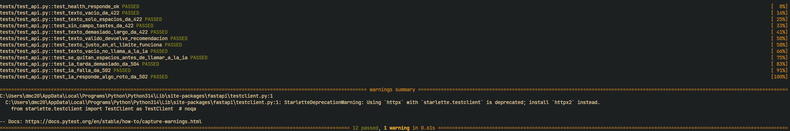

# Pruebas de Musicfy

# App 1

## Objetivo

Comprobar que el backend responde correctamente en cada situación,
sin llamar a la IA real. Las pruebas automáticas usan una IA simulada (mock),
así que no gastan créditos ni necesitan conexión con la API de IA.

Además se documentan las pruebas manuales (PR-13 a PR-17) que la ERS
relaciona con los requisitos que no se pueden comprobar con pytest.

## Entorno

- Python: 3.14.5
- pytest: 9.1.1
- Sistema: Windows

## Cómo ejecutar las pruebas

Desde la carpeta `backend`, con el entorno activado:

    python -m pytest -v

No hace falta tener el backend arrancado ni clave de la API de IA.

## Límites que se comprueban

- Máximo de caracteres para `tastes`: 500
- Tiempo máximo de espera a la IA: 25 segundos
- Máximo de tokens solicitados a la API de Gemini: 600 (configurable con `MAX_TOKENS`)

## Casos de prueba automáticos

| Nº | ID ERS | Situación | Resultado esperado | Test | Estado |
|----|--------|-----------|--------------------|------|--------|
| 1 | PR-01 | Se consulta `/health` | Responde 200 con `status: ok` | `test_health_responde_ok` | Hecho |
| 2 | PR-06 | Se envían unos gustos válidos | Responde 200 y consulta a la IA una sola vez | `test_texto_valido_devuelve_recomendacion` | Hecho |
| 3 | PR-04 | No se envía el campo `tastes` | Responde 422 | `test_sin_campo_tastes_da_422` | Hecho |
| 4 | PR-02, PR-08 | `tastes` está vacío | Responde 422 y no consulta a la IA | `test_texto_vacio_da_422`, `test_texto_vacio_no_llama_a_la_ia` | Hecho |
| 5 | PR-03 | `tastes` solo tiene espacios | Responde 422 | `test_texto_solo_espacios_da_422` | Hecho |
| 6 | PR-07 | `tastes` tiene justo 500 caracteres | Responde 200 | `test_texto_justo_en_el_limite_funciona` | Hecho |
| 7 | PR-05 | `tastes` tiene 501 caracteres | Responde 422 | `test_texto_demasiado_largo_da_422` | Hecho |
| 8 | PR-10 | La IA tarda demasiado | Responde 504 con código `TIMEOUT` | `test_ia_tarda_demasiado_da_504` | Hecho |
| 9 | PR-11 | La IA falla | Responde 502 con código `IA_NO_DISPONIBLE` | `test_ia_falla_da_502` | Hecho |
| 10 | PR-12 | La IA responde algo con formato incorrecto | Responde 502 con código `RESPUESTA_INVALIDA` | `test_ia_responde_algo_roto_da_502` | Hecho |
| 11 | PR-09 | `tastes` llega con espacios al principio y al final | La IA recibe el texto sin esos espacios | `test_se_quitan_espacios_antes_de_llamar_a_la_ia` | Hecho |

## Resultados de ejecución

| Fecha | Comando | Resultado |
|-------|---------|-----------|
| 13/10/2026 | `python -m pytest` | 1 passed |
| 13/10/2026 | `python -m pytest` | 5 passed |
| 13/10/2026 | `python -m pytest` | 9 passed |
| 13/10/2026 | `python -m pytest` | 12 passed |

## Pruebas manuales

### PR-13. Integración real con la API de IA

Probado a mano con la API real y datos ficticios. Hasta el 19/10/2026 el proveedor
era OpenRouter; desde entonces es la API de Gemini de Google.

- 13/10/2026: la petición válida devolvía 502. Con un script de diagnóstico se vio
  que OpenRouter respondía 402 por falta de créditos: al no indicar un máximo de
  tokens, reservaba saldo para la respuesta más larga posible del modelo.
- 13/10/2026: solución aplicada. El backend limita la respuesta mediante `MAX_TOKENS`
  (600 por defecto). Tras el cambio, la misma petición devuelve 200 con
  recomendaciones. Si el saldo de la cuenta se agota del todo, seguiría
  apareciendo el 402 y habría que añadir créditos o cambiar de modelo.
- 19/10/2026: el backend pasa a usar la API de Gemini de Google con el modelo
  `gemini-3.5-flash-lite`. En el despliegue de Vercel, una petición válida devuelve
  recomendaciones y una petición sin datos muestra el mensaje de validación.

### PR-14. La clave no está en el repositorio

- 15/10/2026: búsqueda de la clave de OpenRouter (`sk-or`).
  - En los archivos del proyecto solo aparece en `backend/.env`, que está excluido por `.gitignore`.
  - `git ls-files` solo incluye `backend/.env.example`.
  - `git log --all -p -S "sk-or"` no devuelve resultados: la clave nunca se ha subido al repositorio.
- 19/10/2026 (tras el cambio a Gemini): búsqueda de la clave de la API de Gemini (`AI_API_KEY`) con los mismos pasos.

### PR-15. No se conservan datos

- 15/10/2026:
  - Búsqueda en el código propio de `localStorage`, `sessionStorage`, `indexedDB`, `sqlite` y `open(`: sin resultados.
  - Tras una consulta, al recargar la página el resultado desaparece.
  - En F12 > Aplicación, el almacenamiento local y de sesión no contiene consultas ni resultados.
  - Tras reiniciar el backend y recargar, no aparece ninguna consulta anterior.

### PR-16. Comportamiento del formulario

- 15/10/2026: prueba con las herramientas del navegador (F12, pestaña Red).
  - Géneros y texto: `tastes` = "Géneros: hip hop, r&b. Además: Busco algo relajado. Me gustan artistas como 2pac".
  - Solo géneros: `tastes` = "Géneros: rock, metal.".
  - Sin géneros ni texto: el frontend muestra «Elige algún género o escribe algo sobre la música que te gusta» y no envía ninguna petición.
  - Al pulsar enviar varias veces durante la espera, solo se envía una petición.
  - El resultado se muestra como texto plano: el frontend no usa `v-html`.

### PR-17. Accesibilidad del formulario

- 15/10/2026:
  - Teclado: se llega con Tab a cada género, al cuadro de texto y al botón de enviar, con foco visible. Los géneros se activan con Espacio/Enter.
  - Estado de los géneros: se distingue visualmente cuál está seleccionado y cuál no.
  - Grupo de géneros: `fieldset` con `legend` «Elige géneros».
  - Cuadro de texto: etiqueta visible asociada con `label for`.
  - Vista de 360 px: sin desplazamiento horizontal, también con un resultado largo.
  - Pendiente: repetir la comprobación a 320 px, que es el ancho que fija la ERS (WCAG 2.1, criterio 1.4.10).

## Observaciones

- Al ejecutar pytest aparece un aviso de deprecación de Starlette sobre `httpx`.
  No afecta a los resultados.

# App 2 

## Objetivo

Comprobar que el backend de App 2 se comporta igual que el de App 1 y que,
además, rechaza las peticiones sin una sesión válida de Clerk.
Las pruebas automáticas simulan la IA y el verificador de tokens de Clerk,
así que no gastan créditos ni necesitan cuentas reales.

Los ID de prueba coinciden con los de `docs/ERS-app2.md`. Los nombres de los
tests son provisionales hasta que se implementen.

## Cómo ejecutar las pruebas

Pendiente: carpeta y comando cuando exista el backend de App 2.

## Casos de prueba automáticos

En todos los casos, salvo los de PR-18 a PR-20, se usa un token válido simulado.

| ID ERS | Situación | Resultado esperado | Test | Estado |
|--------|-----------|--------------------|------|--------|
| PR-01 | Se consulta `/health` sin token | Responde 200 con `status: ok` | Pendiente | Pendiente |
| PR-06 | Token válido y gustos válidos | Responde 200 y consulta a la IA una sola vez | Pendiente | Pendiente |
| PR-04 | Token válido y sin campo `tastes` | Responde 422 | Pendiente | Pendiente |
| PR-02, PR-08 | Token válido y `tastes` vacío | Responde 422 y no consulta a la IA | Pendiente | Pendiente |
| PR-03 | Token válido y `tastes` solo con espacios | Responde 422 | Pendiente | Pendiente |
| PR-07 | Token válido y `tastes` con 500 caracteres | Responde 200 | Pendiente | Pendiente |
| PR-05 | Token válido y `tastes` con 501 caracteres | Responde 422 | Pendiente | Pendiente |
| PR-09 | Token válido y `tastes` con espacios al principio y al final | La IA recibe el texto sin esos espacios | Pendiente | Pendiente |
| PR-10 | Token válido y la IA tarda demasiado | Responde 504 con código `TIMEOUT` | Pendiente | Pendiente |
| PR-11 | Token válido y la IA falla | Responde 502 con código `IA_NO_DISPONIBLE` | Pendiente | Pendiente |
| PR-12 | Token válido y la IA responde algo no utilizable | Responde 502 con código `RESPUESTA_INVALIDA` | Pendiente | Pendiente |
| PR-18 | Petición sin cabecera `Authorization` | Responde 401 con código `NO_AUTORIZADO` y no consulta a la IA | `test_sin_token_da_401` (provisional) | Pendiente |
| PR-19 | Token inválido (firma incorrecta, mal formado o de otro emisor) | Responde 401 y no consulta a la IA | `test_token_invalido_da_401` (provisional) | Pendiente |
| PR-20 | Token caducado | Responde 401 y no consulta a la IA | `test_token_caducado_da_401` (provisional) | Pendiente |

## Resultados de ejecución

| Fecha | Comando | Resultado |
|-------|---------|-----------|
| Pendiente | Pendiente | Pendiente |

## Pruebas manuales

| ID ERS | Qué se comprueba | Dónde | Estado |
|--------|------------------|-------|--------|
| PR-13 | Petición válida con la IA real y una sesión real de Clerk: 200 con recomendaciones | Local, Vercel y EC2 | Pendiente |
| PR-14 | La clave de la IA y las claves secretas de Clerk no están en el frontend, el repositorio, su historial ni las imágenes Docker | Repositorio e imágenes | Pendiente |
| PR-15 | No se conservan datos tras recargar la página y reiniciar el backend y los contenedores | Local, Docker y EC2 | Pendiente |
| PR-16 | Formulario: géneros y texto, solo géneros, nada, doble envío y cierre de sesión con un resultado en pantalla | Navegador con F12 | Pendiente |
| PR-17 | Accesibilidad con teclado, incluido el acceso de Clerk, y vista de 320 px | Navegador | Pendiente |
| PR-21 | Sin sesión no se puede enviar; con sesión sí; tras cerrar sesión no; una llamada directa al backend sin token recibe 401 | Vercel y EC2 | Pendiente |
| PR-22 | Desde la URL de Vercel: un caso válido con sesión y uno de error | Vercel | Pendiente |
| PR-23 | Desde la URL HTTPS de EC2, en otro dispositivo: acceso con Clerk, un caso válido, uno de error y reinicio de los contenedores | EC2 | Pendiente |