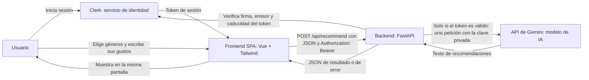
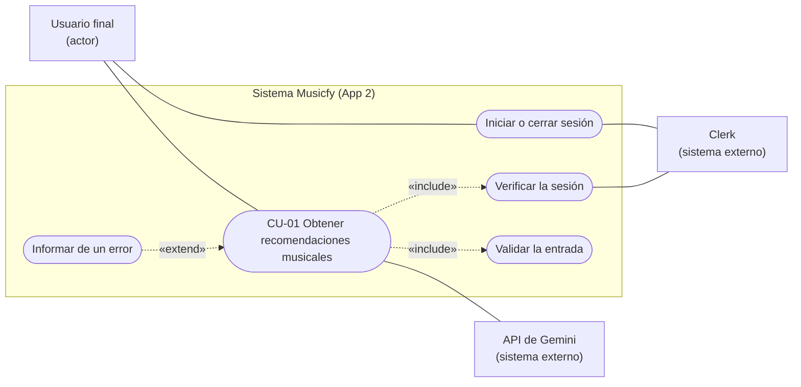
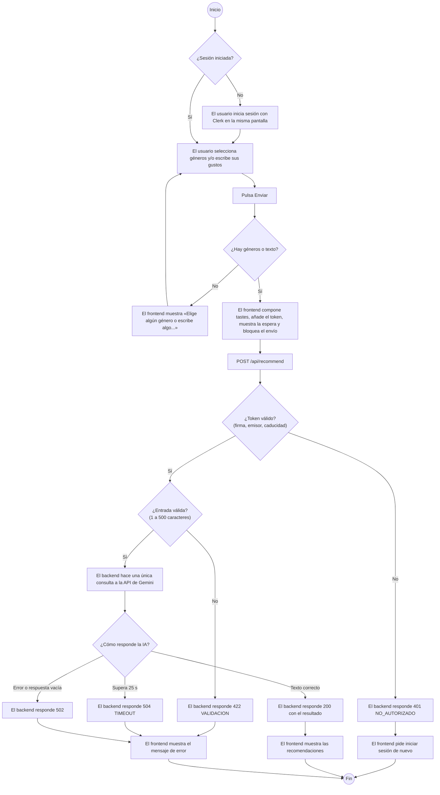
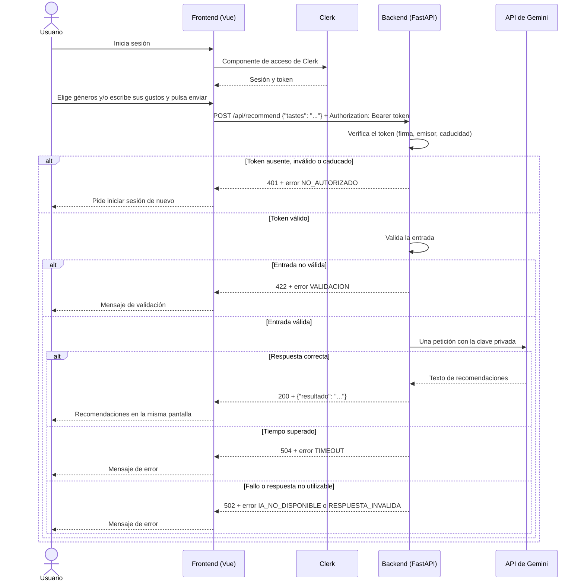

# Especificación de Requisitos del Software (ERS) — Musicfy (App 2)

## Datos del documento

| Campo | Valor |
|---|---|
| Nombre del proyecto | Musicfy — recomendador musical con inteligencia artificial (App 2, con autenticación) |
| Autores | Mario Luna Lopez, Jose Antonio Nieto Perez, David Molina Castillo |
| Curso y grupo | Curso de especialización en Aprendizaje automático: gestión de datos y entrenamiento |
| Asignatura o módulo | Desarrollo de componentes software para sistemas de aprendizaje automático |
| Docente | Francisco Manuel Matías Prados |
| Fecha | 28/10/2026 |
| Versión | 1.0 |
| Estado | Aprobado |

### Historial de cambios

| Versión | Fecha | Autor | Cambios realizados |
|---|---|---|---|
| 0.1 | 25/10/2026 | David | Primera versión, a partir de la ERS de App 1 (versión 1.0). Se añaden la autenticación con Clerk (RF-06, RNF-05), el despliegue en Vercel y en AWS EC2 con Docker, el flujo alternativo de acceso no autorizado y la verificación del token antes de la llamada a la IA. |
| 0.2 | 26/10/2026 | David | Revisión contra spec.md y tasks.md de Spec Kit. FUE-08 completada; INT-04 e INT-05 con las variables de Clerk; PEN-01 y PEN-04 resueltos; PEN-02 y PEN-05 parciales. |
| 0.3 | 27/10/2026 | David | Tests de App 2 implementados: PEN-05 resuelto y sección 8 con los nombres definitivos; INT-04 e INT-05 con las variables de Clerk. |
| 0.4 | 28/10/2026 | David | Correcciones tras la revisión de Jose Antonio Nieto: PEN-02 actualizado (aplicación de Clerk creada), versión de FastAPI y fechas de consulta en las fuentes, navegadores probados y requisitos funcionales verificados. |
| 1.0 | 28/10/2026 | Mario Luna, Jose Antonio Nieto, David Molina | Versión 1.0 definitiva: orígenes de Clerk y URLs de Vercel y EC2 confirmadas (PEN-02, PEN-06), entorno AWS definido (PEN-03), todos los requisitos validados y revisión cruzada completada por los tres integrantes. |

## 1. Introducción

### 1.1. Propósito del documento

Este documento describe qué debe hacer Musicfy en su segunda versión (App 2) y las condiciones que debe cumplir. La App 2 resuelve la misma necesidad que la App 1, con el mismo contrato y el mismo alcance funcional, y añade autenticación con Clerk. Se construye desde cero, guiada por especificaciones con GitHub Spec Kit.

Lo utilizan:

- **El equipo de desarrollo**, como base para la especificación de Spec Kit y para comprobar que la App 2 es equivalente a la App 1 más la autenticación.
- **El docente**, para revisar que la App 2 respeta el alcance obligatorio, que la autenticación protege el backend y que cada requisito tiene una forma objetiva de comprobarse.

Los requisitos RF-01 a RF-05 y RNF-01 a RNF-04 se conservan de la ERS de App 1 (`docs/ERS.md`, versión 1.0), con los ajustes necesarios para la autenticación. Los requisitos nuevos son RF-06 y RNF-05.

### 1.2. Problema y objetivos

**Problema o necesidad:** el mismo que en la App 1. Cuando una persona quiere descubrir música nueva parecida a la que le gusta, suele tener que buscar en varias fuentes o depender de recomendaciones que no explican por qué encajan. Musicfy permite describir los gustos con palabras propias y recibir en una sola pantalla unas pocas recomendaciones explicadas. En la App 2, además, solo los usuarios que han iniciado sesión pueden pedir recomendaciones, lo que evita usos anónimos del servicio de IA.

**Usuario y uso:** cualquier persona que quiera descubrir artistas nuevos inicia sesión, escribe qué música le gusta o qué le apetece escuchar y recibe recomendaciones justificadas.

| ID | Objetivo del proyecto | Indicador de logro |
|---|---|---|
| OBJ-01 | Ofrecer recomendaciones musicales a partir de una descripción libre de los gustos del usuario. | Con sesión iniciada y una entrada válida, la aplicación muestra en la misma pantalla un texto de recomendaciones devuelto por la IA (demostración PR-13). |
| OBJ-02 | Rechazar entradas no válidas sin consultar a la IA. | Las pruebas automáticas de validación pasan y comprueban que no se realiza ninguna llamada a la IA (PR-02 a PR-08). |
| OBJ-03 | Informar al usuario de forma comprensible cuando la IA falla o tarda demasiado. | Las pruebas de error devuelven 502 o 504 con el formato de error acordado (PR-10 a PR-12). |
| OBJ-04 | Mantener las claves privadas fuera del frontend y del repositorio. | La inspección PR-14 no encuentra la clave de la IA ni claves secretas de Clerk en el frontend, el repositorio, su historial ni las imágenes Docker. |
| OBJ-05 | Impedir que se use el servicio de IA sin una sesión válida. | Las pruebas PR-18 a PR-20 y la prueba manual PR-21 demuestran que sin token, o con un token inválido o caducado, el backend responde 401 y no llama a la IA. |
| OBJ-06 | Desplegar la App 2 de forma reproducible en Vercel y en AWS EC2 con Docker. | Las URL de Vercel y de EC2 (HTTPS) responden con un caso válido y uno de error, documentados en `docs/despliegues.md` (PR-22 y PR-23). |

### 1.3. Alcance

**El sistema incluirá:**

- Una única pantalla con un único formulario para describir los gustos musicales, mediante la selección de géneros y un texto libre.
- Inicio y cierre de sesión con Clerk mediante un componente integrado o modal en esa misma pantalla.
- La verificación del token de sesión en el backend antes de procesar la petición.
- La validación de la entrada en el backend.
- Una única consulta a una única API de IA (API de Gemini de Google) por cada envío válido y autenticado.
- La presentación del resultado, o del error correspondiente, en la misma pantalla.
- El despliegue en Vercel y en AWS EC2 con contenedores Docker.

**Queda fuera del alcance:**

- Bases de datos de cualquier tipo y cualquier persistencia de entradas o resultados, incluido `localStorage`, `sessionStorage` o IndexedDB para datos del formulario o de la IA.
- Historial de consultas, favoritos, listas de reproducción o conversaciones con memoria.
- Gestión de usuarios propia: tablas de usuarios, contraseñas, roles, perfiles, endpoints de registro o administración de cuentas. La identidad la gestiona Clerk.
- Páginas o rutas de login, registro, perfil o administración.
- Guardar solicitudes o resultados en la sesión de Clerk.
- Reproducción de música, enlaces a plataformas de streaming o búsquedas en otras APIs.
- Varias pantallas, rutas de navegación, paneles de administración o estadísticas.
- Subida de archivos, pagos, correo, colas o procesos en segundo plano.
- Servicios adicionales en AWS (bases de datos, balanceadores, Kubernetes o registros de imágenes).

### 1.4. Definiciones y abreviaturas

| Término | Definición |
|---|---|
| ERS | Especificación de Requisitos del Software. |
| SPA | *Single Page Application*: aplicación web de una sola página que se actualiza sin recargar. |
| API | Interfaz que permite a un programa comunicarse con otro mediante peticiones. |
| Endpoint | Dirección concreta del backend que atiende un tipo de petición, por ejemplo `POST /api/recommend`. |
| JSON | Formato de texto para intercambiar datos estructurados. |
| LLM | Modelo de lenguaje de gran tamaño que genera texto, en este caso las recomendaciones. |
| API de Gemini | Servicio de Google (Google AI Studio) que da acceso a los modelos Gemini con una clave de API. El backend usa su punto de acceso compatible con el formato de OpenAI. |
| Token (IA) | Unidad en la que el proveedor de IA mide el texto procesado y su coste. |
| Gustos (`tastes`) | Texto libre en el que el usuario describe artistas, géneros, épocas o sensaciones que le gustan. |
| Mock | Sustituto controlado de un componente real que se usa en las pruebas automáticas para no llamar a servicios reales. |
| CORS | Mecanismo del navegador que controla qué páginas web pueden llamar al backend. No autentica ni impide llamadas directas al backend. |
| Clerk | Servicio externo de identidad que gestiona el inicio y cierre de sesión. La aplicación no almacena usuarios. |
| Token de sesión (JWT) | Credencial firmada que emite Clerk tras iniciar sesión. El frontend la envía al backend en la cabecera `Authorization: Bearer ...`. |
| Clave publishable | Clave pública de Clerk que puede estar en el frontend. |
| JWKS | Conjunto de claves públicas del emisor que permite al backend comprobar la firma de un token. |
| 401 | Código HTTP que indica que la petición no está autenticada o que su token no es válido. |
| Spec Kit | Herramienta de GitHub para el desarrollo guiado por especificaciones con un agente de IA. |
| Docker | Herramienta que empaqueta la aplicación en contenedores reproducibles. |
| EC2 | Servicio de AWS que proporciona una máquina virtual donde se ejecutan los contenedores. |

### 1.5. Referencias y fuentes

| ID | Fuente | Fecha o versión | Ubicación |
|---|---|---|---|
| FUE-01 | Enunciado de la práctica «UD1 · Mini aplicación web con una API de IA» | Documentación técnica consultada el 06/10/2026 | Facilitado por el docente |
| FUE-02 | Plantilla `plantillaERS.md` | Versión facilitada por el docente | Facilitada por el docente |
| FUE-03 | Decisiones del equipo (proveedor de IA, límites y contrato) | Octubre de 2026 | `docs/uso-ia.md` |
| FUE-04 | Documentación oficial de FastAPI | Versión 0.162.0 (App 2) | https://fastapi.tiangolo.com |
| FUE-05 | Documentación oficial de la API de Gemini | Consultada el 19/10/2026 | https://ai.google.dev/gemini-api/docs |
| FUE-06 | ERS de App 1 | Versión 1.0, 25/10/2026 | `docs/ERS.md` |
| FUE-07 | Documentación de Clerk: tokens de sesión y verificación manual de JWT | Consultada el 28/10/2026 | https://clerk.com/docs/guides/sessions/session-tokens |
| FUE-08 | Repositorio oficial de GitHub Spec Kit |  Versión 1.2.4.dev0, con Claude Code como agente| https://github.com/github/spec-kit |
| FUE-09 | Documentación de AWS EC2 (grupos de seguridad) | Consultada el 28/10/2026| https://docs.aws.amazon.com/AWSEC2/latest/UserGuide/ec2-security-groups.html |

## 2. Descripción general del sistema

### 2.1. Contexto y perspectiva del producto

Musicfy App 2 es un proyecto nuevo, construido desde una carpeta vacía con Spec Kit, que reproduce la función de la App 1 y añade autenticación. Se compone de:

- Un **frontend** SPA en Vue.js con Tailwind CSS, que muestra el acceso de Clerk, el formulario y el resultado en una sola pantalla.
- Un **backend** en Python con FastAPI, que verifica el token de sesión, valida la entrada, consulta a la IA y devuelve JSON.
- Un **servicio de identidad externo**, Clerk, que gestiona el inicio y cierre de sesión y emite los tokens.
- Un **proveedor de IA externo**, la API de Gemini de Google, al que el backend envía una única petición por consulta autorizada.

El frontend nunca se comunica directamente con la IA. Clerk y la IA son servicios distintos: Clerk solo identifica al usuario, y la IA solo genera las recomendaciones.

Se despliega en dos entornos: Vercel (frontend estático y backend como función serverless) y una instancia AWS EC2 con contenedores Docker y HTTPS.

Diagrama de arquitectura y contexto (aclara qué componentes existen, por dónde circulan los datos y que la verificación del token ocurre antes de la llamada a la IA):

### 2.2. Personas interesadas y tipos de usuario

| ID | Persona, colectivo o rol | Necesidad o responsabilidad | Permisos y conocimientos relevantes |
|---|---|---|---|
| ACT-01 | Usuario final | Descubrir música nueva a partir de sus gustos. | Inicia sesión con Clerk en la única pantalla. Con sesión iniciada puede pedir recomendaciones. No necesita conocimientos técnicos. |
| ACT-02 | Equipo de desarrollo | Especificar, construir con asistencia de IA, probar, desplegar y documentar la aplicación. | Acceso al repositorio, a la configuración privada del backend, a la aplicación de Clerk y a la instancia de AWS. |
| ACT-03 | Docente | Revisar el cumplimiento del enunciado y evaluar la práctica. | Acceso al repositorio, la documentación y las URL desplegadas. |

No existe un rol de administrador funcional dentro de la aplicación. Todos los usuarios con sesión iniciada tienen los mismos permisos.

### 2.3. Funciones principales

Musicfy ofrece una única función útil, compuesta por cuatro partes:

- **Identificarse** con Clerk en la misma pantalla.
- **Introducir** los gustos musicales en el formulario: seleccionar géneros y describir con texto libre el estado de ánimo, los artistas u otras preferencias.
- **Procesar** la petición: verificar la sesión, validar la entrada y obtener recomendaciones mediante una consulta a la IA.
- **Mostrar** las recomendaciones, o un mensaje de error comprensible, en la misma pantalla.

### 2.4. Entorno de uso

| Aspecto | Descripción |
|---|---|
| Dispositivos y plataformas | Navegadores actuales de escritorio y móvil. App 2 probada en Chrome, en ordenador y en la vista móvil de las herramientas de desarrollo |
| Condiciones de uso | Requiere conexión a internet y una cuenta de Clerk. Uso puntual: una consulta cada vez. Acceso por HTTPS en ambos despliegues. |
| Volumen esperado | Volumen de demostración académica: consultas manuales del equipo y del docente. No se establecen cifras de capacidad porque no se han medido. |

### 2.5. Restricciones

| ID | Restricción | Origen o justificación |
|---|---|---|
| RES-01 | Backend en Python con FastAPI. | Obligatorio (FUE-01). |
| RES-02 | Frontend como SPA en Vue.js con Tailwind CSS. | Obligatorio elegir Vue o React y usar Tailwind (FUE-01). Vue es elección del equipo. |
| RES-03 | Una sola pantalla, un solo formulario, una sola función y una sola API de IA. | Regla obligatoria de simplicidad (FUE-01). |
| RES-04 | Sin bases de datos ni persistencia de entradas o resultados. | Prohibición expresa (FUE-01). |
| RES-05 | La clave del proveedor de IA y cualquier clave secreta de Clerk solo pueden estar en el backend, en variables de entorno. En el frontend solo puede estar la clave publishable de Clerk. | Seguridad (FUE-01). |
| RES-06 | Pruebas automáticas con pytest, con la IA y el verificador de tokens simulados mediante mocks. | Obligatorio (FUE-01). |
| RES-07 | Despliegue de frontend y backend en Vercel, y después en AWS EC2 con Docker y HTTPS. | Obligatorio (FUE-01). |
| RES-08 | Uso del plan gratuito de la API de Gemini, con límites de peticiones; cada petición limita la respuesta a un máximo de tokens. | Presupuesto disponible del equipo (FUE-03). |
| RES-09 | Proyecto nuevo desde una carpeta vacía, guiado por Spec Kit. La especificación, el plan y las tareas deben estar en Git antes que el código. No se copia la implementación de App 1. | Obligatorio (FUE-01). |
| RES-10 | Identidad gestionada exclusivamente por Clerk, con acceso en la misma pantalla. | Obligatorio (FUE-01). |
| RES-11 | Uso de AWS dentro del acceso, la región y el presupuesto indicados por el docente; los recursos se retiran al terminar. | Indicaciones del docente (FUE-01). |
| RES-12 | Equipo de tres personas y plazo fijado por el docente. | Organización de la práctica (FUE-01). |

### 2.6. Suposiciones y dependencias

| ID | Tipo | Descripción | Consecuencia si no se cumple |
|---|---|---|---|
| DEP-01 | Dependencia | Servicio de la API de Gemini disponible y modelo configurado accesible. | La aplicación no puede generar recomendaciones y muestra el error 502 o 504 controlado. |
| DEP-02 | Dependencia | Cuota del plan gratuito de la API de Gemini no agotada. | La API rechaza la petición y la aplicación muestra el error 502 controlado. |
| DEP-03 | Dependencia | Cuentas de Vercel disponibles para el despliegue. | Sin ellas no puede publicarse la App 2 en Vercel. |
| DEP-04 | Dependencia | Servicio de Clerk disponible y aplicación configurada con los orígenes de local, Vercel y EC2. | El usuario no puede iniciar sesión, el backend no puede verificar tokens y responde 401; no se consulta a la IA. |
| DEP-05 | Dependencia | Acceso a AWS y un nombre de dominio con certificado HTTPS para la instancia EC2. | Pendiente de confirmar con el docente. Sin HTTPS no se pueden enviar tokens de forma segura y no puede completarse el despliegue en EC2. |
| SUP-01 | Suposición | El modelo de IA sigue las instrucciones del prompt (responder en español con entre 3 y 5 recomendaciones). | El texto puede variar en número o formato. El backend solo garantiza que el resultado no esté vacío; el contenido no se promete exacto. |

## 3. Requisitos funcionales

**Prioridades:** Alta = imprescindible para la versión prevista; Media = importante, pero puede aplazarse mediante acuerdo; Baja = deseable.

### 3.1. Catálogo de requisitos funcionales

| ID | Nombre | Prioridad | Fuente | Estado |
|---|---|---|---|---|
| RF-01 | Introducir los gustos musicales | Alta | FUE-01, FUE-06 | Validado |
| RF-02 | Validar la entrada | Alta | FUE-01, FUE-06 | Validado |
| RF-03 | Obtener recomendaciones de la IA | Alta | FUE-01, FUE-06 | Validado |
| RF-04 | Mostrar el resultado en la misma pantalla | Alta | FUE-01, FUE-06 | Validado |
| RF-05 | Informar de los errores del proveedor de IA | Alta | FUE-01, FUE-06 | Validado |
| RF-06 | Autenticar al usuario y proteger el backend | Alta | FUE-01, FUE-07 | Validado |

### 3.2. Fichas de requisitos funcionales

#### RF-01. Introducir los gustos musicales

| Campo | Descripción |
|---|---|
| Enunciado | El sistema deberá ofrecer, a un usuario con sesión iniciada, un formulario en el que seleccione géneros musicales y describa con texto libre sus preferencias, y un botón para enviarlo. |
| Justificación | Es la única entrada de datos de la aplicación. |
| Actor | ACT-01 Usuario final |
| Prioridad | Alta |
| Fuente | FUE-01, FUE-06 |
| Precondiciones | La pantalla de Musicfy está cargada y el usuario ha iniciado sesión (RF-06). |
| Entradas | Géneros seleccionados (opcionales, uno o varios) y texto libre (opcional). |
| Comportamiento esperado | El frontend compone un único texto con el formato `Géneros: <lista>. Además: <texto libre>`, obtiene el token de sesión de Clerk y envía la petición `POST /api/recommend` con el texto en el campo `tastes` y la cabecera `Authorization: Bearer <token>`. |
| Salidas y postcondiciones | La petición queda enviada y la pantalla pasa al estado de espera. |
| Errores o alternativas | Mientras hay una petición pendiente, el formulario no permite un segundo envío. Si no se ha seleccionado ningún género ni escrito texto, el frontend no envía la petición y muestra el mensaje «Elige algún género o escribe algo sobre la música que te gusta». Sin sesión iniciada, el formulario no permite enviar y se muestra el acceso de Clerk. El texto compuesto, incluidos los géneros, está sujeto al límite de 500 caracteres. |
| Dependencias | RF-02, RF-03, RF-06 |

**Criterios de aceptación:**

- **CA-RF01-01:** Dado un usuario con sesión iniciada que ha seleccionado géneros y escrito un texto, cuando pulsa enviar, entonces se envía una única petición al backend con `tastes` y la cabecera `Authorization`.
- **CA-RF01-02:** Dado un usuario con sesión iniciada que solo ha seleccionado géneros, cuando pulsa enviar, entonces se envía una petición cuyo campo `tastes` contiene esos géneros.
- **CA-RF01-03:** Dado que hay una petición en curso, cuando el usuario vuelve a pulsar enviar, entonces no se envía una segunda petición.
- **CA-RF01-04:** Dado que el usuario no ha seleccionado géneros ni escrito texto, cuando intenta enviar, entonces el frontend muestra el mensaje de validación y no se envía ninguna petición.

#### RF-02. Validar la entrada

| Campo | Descripción |
|---|---|
| Enunciado | El sistema deberá rechazar en el backend las peticiones autenticadas cuyo campo `tastes` falte, esté vacío, contenga solo espacios o supere los 500 caracteres tras eliminar los espacios iniciales y finales. |
| Justificación | Evitar consultas inútiles o abusivas a la IA y proteger la cuota. |
| Actor | Backend |
| Prioridad | Alta |
| Fuente | FUE-01, FUE-06 |
| Precondiciones | Llega una petición a `POST /api/recommend` con un token válido (RF-06). |
| Entradas | Campo `tastes`: texto obligatorio, entre 1 y 500 caracteres tras eliminar espacios iniciales y finales. El límite es configurable con `MAX_CARACTERES`. |
| Comportamiento esperado | Si la entrada es válida, elimina los espacios iniciales y finales y continúa con RF-03. Si no lo es, responde sin consultar a la IA. |
| Salidas y postcondiciones | Entrada no válida: código 422 con `{"error": {"codigo": "VALIDACION", "mensaje": "..."}}`. |
| Errores o alternativas | La validación del frontend ayuda al usuario pero no sustituye a la del backend. Una petición sin token válido se rechaza con 401 (RF-06), sea cual sea su contenido. |
| Dependencias | RF-03, RF-06 |

**Criterios de aceptación:**

- **CA-RF02-01:** Dado un token válido y un texto vacío, cuando se envía, entonces el backend responde 422 con el código `VALIDACION` y no llama a la IA.
- **CA-RF02-02:** Dado un token válido y un texto formado solo por espacios, cuando se envía, entonces el backend responde 422.
- **CA-RF02-03:** Dado un token válido y una petición sin el campo `tastes`, cuando se envía, entonces el backend responde 422.
- **CA-RF02-04:** Dado un token válido y un texto de exactamente 500 caracteres, cuando se envía, entonces se acepta.
- **CA-RF02-05:** Dado un token válido y un texto de 501 caracteres, cuando se envía, entonces el backend responde 422.

#### RF-03. Obtener recomendaciones de la IA

| Campo | Descripción |
|---|---|
| Enunciado | El sistema deberá realizar exactamente una consulta a la API de Gemini por cada envío autenticado y válido, con el texto validado del usuario, y devolver el texto obtenido en formato JSON. |
| Justificación | Es la función principal de la aplicación. |
| Actor | Backend |
| Prioridad | Alta |
| Fuente | FUE-01, FUE-06 |
| Precondiciones | El token es válido (RF-06) y la entrada ha superado RF-02. La clave y el modelo están configurados en el backend. |
| Entradas | Texto validado (`tastes`). |
| Comportamiento esperado | Envía a la API de Gemini las instrucciones del recomendador y el texto del usuario, con un máximo de tokens de respuesta y un tiempo máximo de espera. Comprueba que la respuesta contiene texto. No envía a la IA el token de sesión ni datos de identidad del usuario. |
| Salidas y postcondiciones | Código 200 con `{"resultado": "texto de las recomendaciones"}`. No se conserva nada tras la respuesta. |
| Errores o alternativas | Ver RF-05. |
| Dependencias | RF-02, RF-05, RF-06, DEP-01, DEP-02 |

**Criterios de aceptación:**

- **CA-RF03-01:** Dado un token válido, un texto válido y una IA simulada que responde correctamente, cuando se envía, entonces el backend responde 200 con el resultado de la IA y la IA se ha llamado una sola vez con el texto del usuario.
- **CA-RF03-02:** Dado un token válido y un texto con espacios al principio y al final, cuando se envía, entonces la IA recibe el texto sin esos espacios.

#### RF-04. Mostrar el resultado en la misma pantalla

| Campo | Descripción |
|---|---|
| Enunciado | El sistema deberá mostrar el resultado o el mensaje de error en la misma pantalla del formulario, como texto plano y sustituyendo cualquier resultado anterior. |
| Justificación | Regla de una sola pantalla y seguridad ante contenido generado por la IA. |
| Actor | ACT-01 Usuario final |
| Prioridad | Alta |
| Fuente | FUE-01, FUE-06 |
| Precondiciones | El backend ha respondido. |
| Entradas | JSON de resultado o de error. |
| Comportamiento esperado | Mientras espera, muestra un indicador de carga. Al recibir la respuesta, muestra el texto del resultado o el mensaje de error. Ante un 401, informa de que hay que iniciar sesión de nuevo. No interpreta HTML ni ejecuta código devuelto por la IA. |
| Salidas y postcondiciones | El usuario ve el resultado o el error. No se acumulan resultados anteriores ni se guardan. Al cerrar sesión, el resultado mostrado se borra de la pantalla. |
| Errores o alternativas | Un texto de respuesta largo no debe romper el diseño. |
| Dependencias | RF-03, RF-05, RF-06 |

**Criterios de aceptación:**

- **CA-RF04-01:** Dado un envío autenticado y válido, cuando el backend responde 200, entonces el texto aparece en la misma pantalla, sin navegar a otra.
- **CA-RF04-02:** Dado un resultado previo en pantalla, cuando se hace una nueva consulta, entonces solo se muestra el nuevo resultado.
- **CA-RF04-03:** Dada una respuesta que contiene etiquetas HTML, cuando se muestra, entonces aparecen como texto y no se interpretan.
- **CA-RF04-04:** Dado un resultado en pantalla, cuando el usuario cierra sesión, entonces el resultado deja de mostrarse.

#### RF-05. Informar de los errores del proveedor de IA

| Campo | Descripción |
|---|---|
| Enunciado | El sistema deberá devolver un error controlado, sin detalles internos, cuando la IA no responda a tiempo, falle o devuelva una respuesta sin contenido utilizable. |
| Justificación | El usuario debe entender qué ha pasado y no deben exponerse datos internos ni secretos. |
| Actor | Backend y frontend |
| Prioridad | Alta |
| Fuente | FUE-01, FUE-06 |
| Precondiciones | El token es válido, la entrada es válida y se ha consultado a la IA. |
| Entradas | Respuesta o fallo del proveedor de IA. |
| Comportamiento esperado | Convierte cada situación en el código y el mensaje acordados. El frontend muestra el mensaje en la misma pantalla. |
| Salidas y postcondiciones | Tiempo de espera superado: 504 con código `TIMEOUT`. Fallo de conexión o respuesta de error del proveedor: 502 con código `IA_NO_DISPONIBLE`. Respuesta sin texto utilizable: 502 con código `RESPUESTA_INVALIDA`. Error inesperado: 500 con código `ERROR_INTERNO`. |
| Errores o alternativas | Las respuestas de error nunca incluyen trazas de error, claves, tokens ni la respuesta completa del proveedor. |
| Dependencias | RF-03, DEP-01, DEP-02 |

**Criterios de aceptación:**

- **CA-RF05-01:** Dada una IA simulada que supera el tiempo máximo, cuando se envía una petición autenticada y válida, entonces el backend responde 504 con el código `TIMEOUT`.
- **CA-RF05-02:** Dada una IA simulada que falla, cuando se envía una petición autenticada y válida, entonces el backend responde 502 con el código `IA_NO_DISPONIBLE`.
- **CA-RF05-03:** Dada una IA simulada que devuelve una respuesta sin contenido utilizable, cuando se envía una petición autenticada y válida, entonces el backend responde 502 con el código `RESPUESTA_INVALIDA`.

#### RF-06. Autenticar al usuario y proteger el backend

| Campo | Descripción |
|---|---|
| Enunciado | El sistema deberá permitir iniciar y cerrar sesión con Clerk en la misma pantalla, y el backend deberá rechazar con 401, sin consultar a la IA, toda petición a `POST /api/recommend` que no incluya un token de sesión de Clerk válido. |
| Justificación | Evitar el uso anónimo del servicio de IA y cumplir la autenticación obligatoria de la App 2. |
| Actor | ACT-01 Usuario final y backend |
| Prioridad | Alta |
| Fuente | FUE-01, FUE-07 |
| Precondiciones | La aplicación de Clerk está configurada con los orígenes de local, Vercel y EC2 (DEP-04). |
| Entradas | Credenciales del usuario, introducidas en el componente de Clerk. Cabecera `Authorization: Bearer <token>` en cada petición al backend. |
| Comportamiento esperado | El frontend muestra un componente de Clerk integrado o modal en la misma pantalla, sin rutas nuevas. Tras iniciar sesión, obtiene el token y lo envía en cada petición. El backend verifica el token **antes** de validar la entrada y de llamar a la IA, mediante el SDK oficial o las claves públicas del emisor (JWKS): firma, emisor, caducidad y orígenes autorizados. No basta con decodificar el token. |
| Salidas y postcondiciones | Token válido: la petición continúa con RF-02. Token ausente, mal formado, con firma no válida, de otro emisor o caducado: código 401 con `{"error": {"codigo": "NO_AUTORIZADO", "mensaje": "..."}}`. La aplicación no guarda usuarios ni datos de la sesión más allá de lo que gestiona el SDK de Clerk. |
| Errores o alternativas | Si Clerk no está disponible, no se puede iniciar sesión y el backend no puede verificar tokens: responde 401 y no consulta a la IA. Ocultar el botón en el frontend no sustituye la verificación en el backend: una llamada directa al backend sin token también se rechaza. |
| Dependencias | RF-01, RF-02, DEP-04 |

**Criterios de aceptación:**

- **CA-RF06-01:** Dada una petición sin cabecera `Authorization`, cuando se envía al backend, entonces responde 401 con el código `NO_AUTORIZADO` y no llama a la IA.
- **CA-RF06-02:** Dada una petición con un token inválido (firma incorrecta, mal formado o de otro emisor), cuando se envía, entonces el backend responde 401 y no llama a la IA.
- **CA-RF06-03:** Dada una petición con un token caducado, cuando se envía, entonces el backend responde 401 y no llama a la IA.
- **CA-RF06-04:** Dada una petición con un token válido y un texto válido, cuando se envía, entonces la petición continúa y el backend responde 200.
- **CA-RF06-05:** Dado un usuario sin sesión, cuando abre la aplicación, entonces ve el acceso de Clerk en la misma pantalla y no puede enviar el formulario; tras iniciar sesión puede enviarlo, y tras cerrar sesión deja de poder hacerlo.

## 4. Requisitos no funcionales

| ID | Categoría | Requisito medible | Condiciones de comprobación | Criterio de aceptación | Prioridad |
|---|---|---|---|---|---|
| RNF-01 | Seguridad | La clave de la API de Gemini y cualquier clave secreta de Clerk solo existen en la configuración privada del backend. | Revisar el código del frontend, el paquete compilado del frontend, el repositorio y su historial, y las imágenes Docker. | Ninguna de esas claves aparece en esos lugares. `.env` está excluido en `.gitignore` y `.dockerignore`, y solo se versiona `.env.example` con valores ficticios. En el frontend solo aparece la clave publishable de Clerk. | Alta |
| RNF-02 | Fiabilidad | Si la IA no responde en 25 segundos (configurable con `AI_TIMEOUT_SECONDS`), el backend deja de esperar y devuelve el error acordado. | Prueba automática con la IA simulada lanzando el error de tiempo superado. | Respuesta 504 con `{"error": {"codigo": "TIMEOUT", ...}}`, sin traza de error ni detalles internos. | Alta |
| RNF-03 | Privacidad | El sistema no conserva las entradas ni los resultados después de responder, tampoco en la sesión de Clerk. | Inspección del código y reinicio del backend (en Vercel y con `docker compose down` y `up` en local y en EC2) y recarga del frontend. | Tras el reinicio y la recarga no aparece ninguna consulta ni resultado anterior. Los registros técnicos no incluyen textos, respuestas, tokens ni secretos. | Alta |
| RNF-04 | Usabilidad y accesibilidad | El formulario, incluidos los botones de género y el acceso de Clerk, se puede usar con teclado y en pantallas de móvil. | Navegador de escritorio y vista de 320 px de ancho. | El campo de texto tiene etiqueta visible asociada; el grupo de géneros tiene un nombre accesible; se llega a cada género, al campo, al botón y al acceso de Clerk con el tabulador, con foco visible; el estado seleccionado de un género no depende solo del color; y la página no tiene desplazamiento horizontal a 320 px. | Media |
| RNF-05 | Seguridad | La verificación del token comprueba firma, emisor y caducidad, y los tokens solo viajan por HTTPS en los despliegues. | Pruebas automáticas con un verificador simulado (PR-18 a PR-20) y prueba manual en Vercel y en EC2 (PR-21). | Sin token, con token inválido o con token caducado: 401 sin llamada a la IA. Los despliegues de Vercel y EC2 se sirven por HTTPS. | Alta |

## 5. Datos y reglas de negocio

### 5.1. Información que gestionará el sistema

Todos los datos de la aplicación son **transitorios**: existen en memoria solo mientras se procesa y se muestra cada consulta. Los datos de identidad los gestiona Clerk; la aplicación no los almacena.

| ID | Entidad o conjunto de datos | Campos principales | Validaciones | Acceso y conservación |
|---|---|---|---|---|
| DAT-01 | Petición de recomendación | `tastes`: texto compuesto por el frontend con el formato `Géneros: <lista>. Además: <texto libre>`; puede faltar cualquiera de las dos partes, pero no ambas. | Obligatorio; entre 1 y 500 caracteres tras eliminar espacios iniciales y finales, incluidos los géneros. | Lo envía el frontend al backend y el backend a la IA. No se conserva. |
| DAT-02 | Respuesta de recomendación | `resultado`: texto | No vacío. | La genera la IA y la devuelve el backend al frontend. No se conserva. |
| DAT-03 | Respuesta de error | `error.codigo`: texto; `error.mensaje`: texto | `codigo` es uno de `VALIDACION`, `NO_AUTORIZADO`, `TIMEOUT`, `IA_NO_DISPONIBLE`, `RESPUESTA_INVALIDA` o `ERROR_INTERNO`. | La devuelve el backend al frontend. No se conserva. |
| DAT-04 | Token de sesión | JWT emitido por Clerk, enviado en la cabecera `Authorization`. | Firma válida, emisor de la aplicación de Clerk configurada y no caducado. | Lo gestiona el SDK de Clerk en el frontend. El backend solo lo verifica en cada petición; no lo guarda ni lo registra, ni lo envía a la IA. |

### 5.2. Reglas de negocio

No aplica: la aplicación no tiene condiciones propias del ámbito del problema que el sistema deba hacer cumplir. Las condiciones existentes son validaciones técnicas de la entrada (RF-02) y de la autenticación (RF-06). El número de recomendaciones y su formato son instrucciones al modelo de IA (SUP-01) y no se garantizan.

## 6. Interfaces externas

### 6.1. Interfaz de usuario

| ID | Pantalla o interacción | Usuarios | Información y acciones necesarias | Requisitos relacionados |
|---|---|---|---|---|
| IU-01 | Pantalla única de Musicfy | ACT-01 | Título de la aplicación; acceso de Clerk integrado o modal (iniciar y cerrar sesión) en la misma pantalla; grupo de botones de género de selección múltiple, con el estado de cada uno visible; campo de texto etiquetado; botón de envío, solo disponible con sesión iniciada; mensaje de validación cuando no hay géneros ni texto; indicador de espera; zona de resultado; zona de mensaje de error, incluido el de sesión no válida. | RF-01, RF-04, RF-05, RF-06, RNF-04 |

La pantalla tiene cinco estados: **sin sesión** (acceso de Clerk visible y envío no disponible), **entrada** (sesión iniciada y formulario listo), **espera** (petición en curso y envío bloqueado), **resultado** (recomendaciones visibles) y **error** (mensaje comprensible).

### 6.2. Interfaces con otros sistemas o dispositivos

| ID | Sistema o dispositivo externo | Información intercambiada | Dirección y momento del intercambio | Formato o protocolo exigido | Respuesta ante fallos |
|---|---|---|---|---|---|
| INT-01 | Backend de Musicfy (desde el frontend) | Envío: `{"tastes": "..."}` y cabecera `Authorization: Bearer <token>`. Respuesta: `{"resultado": "..."}` o `{"error": {"codigo": "...", "mensaje": "..."}}`. | Ambas, en cada envío del formulario. | HTTPS `POST /api/recommend` con JSON. Códigos: 200, 401, 422, 500, 502 y 504. CORS permite la cabecera `Authorization` desde los orígenes del frontend. | El frontend muestra el mensaje de error recibido en la misma pantalla. |
| INT-02 | API de Gemini de Google (desde el backend) | Envío: modelo, instrucciones del recomendador, texto del usuario y máximo de tokens. Respuesta: texto generado. | Ambas, una vez por envío autenticado y válido. | HTTPS con JSON en el formato compatible con OpenAI. Clave en la cabecera `Authorization`, leída de `GEMINI_API_KEY`. Dirección configurable con `GEMINI_URL`, modelo con `GEMINI_MODEL` y máximo de tokens con `MAX_TOKENS`. | Tiempo superado: 504. Error del proveedor o de conexión: 502. Respuesta sin texto: 502. |
| INT-03 | Comprobación de estado (técnica) | Respuesta: `{"status": "ok", ...}` | Salida, cuando se consulta. | HTTP `GET /health`, sin autenticación. | No aplica: es un endpoint técnico sin interfaz de usuario. |
| INT-04 | Clerk (desde el frontend) | Inicio y cierre de sesión; obtención del token de sesión. | Ambas, al iniciar o cerrar sesión y antes de cada envío. | SDK oficial de Clerk compatible con Vue, con la clave publishable. Paquete @clerk/vue; clave en VITE_CLERK_PUBLISHABLE_KEY. | Si Clerk no responde, no se puede iniciar sesión y el formulario no permite enviar. |
| INT-05 | Clerk (desde el backend) | Claves públicas del emisor para verificar los tokens. | Entrada, cuando el backend verifica un token. | PyJWT con el JWKS del emisor; variables CLERK_ISSUER y CLERK_JWKS_URL. | Si no se puede verificar el token, el backend responde 401 y no consulta a la IA. |

## 7. Casos de uso o escenarios de usuario

Diagrama de casos de uso (notación UML adaptada a Mermaid). Muestra quién interactúa con el sistema y qué puede hacer: un actor humano, un caso de uso principal que incluye la verificación de la sesión, y Clerk y la IA como sistemas externos distintos.

### CU-01. Obtener recomendaciones musicales

| Campo | Descripción |
|---|---|
| Objetivo | Recibir recomendaciones de música a partir de una descripción de los gustos. |
| Actor principal | ACT-01 Usuario final |
| Precondiciones | La pantalla de Musicfy está cargada, el backend está disponible y el usuario ha iniciado sesión con Clerk. |
| Evento de inicio | El usuario selecciona géneros y/o escribe sus gustos y pulsa enviar. |
| Requisitos relacionados | RF-01 a RF-06, RNF-01, RNF-02, RNF-03, RNF-05 |

**Flujo principal:**

1. El usuario inicia sesión con Clerk en la misma pantalla.
2. El usuario selecciona géneros y/o escribe sus gustos musicales y pulsa enviar.
3. El frontend muestra el estado de espera, bloquea un nuevo envío y envía la petición al backend con el token de sesión.
4. El backend verifica el token.
5. El backend valida la entrada.
6. El backend realiza una única consulta a la API de Gemini.
7. La API de Gemini devuelve el texto de recomendaciones.
8. El backend devuelve 200 con el resultado.
9. El frontend muestra el resultado en la misma pantalla.

**Flujos alternativos y excepciones:**

- **A0 — Formulario vacío:** en el paso 2, si no hay géneros seleccionados ni texto, el frontend muestra «Elige algún género o escribe algo sobre la música que te gusta», no envía la petición y el flujo vuelve al paso 2.
- **A1 — Acceso no autorizado:** en el paso 4, si la petición no tiene token o el token es inválido o ha caducado, el backend responde 401 con `NO_AUTORIZADO` sin validar la entrada ni consultar a la IA, el frontend pide iniciar sesión de nuevo y el flujo vuelve al paso 1. Lo mismo ocurre ante una llamada directa al backend sin pasar por el frontend.
- **A2 — Entrada no válida:** en el paso 5, si el texto falta, está vacío, solo tiene espacios o supera 500 caracteres, el backend responde 422 sin consultar a la IA, el frontend muestra el mensaje de validación y el flujo termina.
- **A3 — La IA tarda demasiado:** en el paso 6, si no hay respuesta en 25 segundos, el backend responde 504, el frontend muestra el mensaje de error y el flujo termina.
- **A4 — La IA falla:** en el paso 6, si hay un error de conexión o el proveedor responde con un error, el backend responde 502 con `IA_NO_DISPONIBLE`, el frontend muestra el mensaje y el flujo termina.
- **A5 — Respuesta no utilizable:** en el paso 7, si la respuesta no contiene texto, el backend responde 502 con `RESPUESTA_INVALIDA`, el frontend muestra el mensaje y el flujo termina.

**Postcondiciones:** el usuario ve el resultado o un mensaje de error. En ningún caso se guarda la entrada ni el resultado.

Diagrama de actividad (notación UML adaptada a Mermaid). Muestra el recorrido completo de una consulta y que la verificación del token ocurre antes de la validación y de la llamada a la IA.

## 8. Verificación y trazabilidad

Las pruebas automáticas se ejecutan con `python -m pytest` en el backend de App 2. Simulan la IA y el verificador de tokens de Clerk, y no consultan servicios reales. Los resultados de las pruebas automáticas y manuales se registran en `docs/pruebas.md`. 

| Requisito | Objetivo o necesidad de origen | Criterio de aceptación | ID de prueba | Método y datos de comprobación | Resultado esperado |
|---|---|---|---|---|---|
| RF-01 | OBJ-01 | CA-RF01-01 a CA-RF01-04 | PR-16 | Demostración manual con F12 abierto y sesión iniciada: enviar géneros y texto, solo géneros, nada, y pulsar enviar varias veces durante la espera. | `tastes` y cabecera `Authorization` presentes; una sola petición; mensaje de validación cuando no hay nada. |
| RF-02 | OBJ-02 | CA-RF02-01 | PR-02, PR-08 | Tests de texto vacío con token válido simulado, incluido que la IA no se llama. | 422 con `VALIDACION`; la IA simulada no se llama. |
| RF-02 | OBJ-02 | CA-RF02-02 | PR-03 | Test de texto solo con espacios. | 422. |
| RF-02 | OBJ-02 | CA-RF02-03 | PR-04 | Test sin campo `tastes`. | 422. |
| RF-02 | OBJ-02 | CA-RF02-04 | PR-07 | Test con 500 caracteres. | 200. |
| RF-02 | OBJ-02 | CA-RF02-05 | PR-05 | Test con 501 caracteres. | 422. |
| RF-03 | OBJ-01 | CA-RF03-01 | PR-06 | Test de texto válido con token válido simulado. | 200 con el resultado simulado; una única llamada a la IA con el texto del usuario. |
| RF-03 | OBJ-01 | CA-RF03-02 | PR-09 | Test de espacios iniciales y finales. | La IA simulada recibe el texto sin esos espacios. |
| RF-03 | OBJ-01 | CA-RF03-01 | PR-13 | Prueba manual con la API de Gemini real, sesión real de Clerk y datos ficticios, en local y en los despliegues. | 200 con un texto de recomendaciones no vacío. |
| RF-04 | OBJ-01 | CA-RF04-01 a CA-RF04-04 | PR-16 | Demostración manual: dos consultas seguidas, una respuesta con etiquetas HTML y cierre de sesión con un resultado en pantalla. | Resultado en la misma pantalla, sin acumular, HTML mostrado como texto y resultado borrado al cerrar sesión. |
| RF-05 | OBJ-03 | CA-RF05-01 | PR-10 | Test de IA lenta simulada. | 504 con `TIMEOUT`. |
| RF-05 | OBJ-03 | CA-RF05-02 | PR-11 | Test de IA que falla. | 502 con `IA_NO_DISPONIBLE`. |
| RF-05 | OBJ-03 | CA-RF05-03 | PR-12 | Test de respuesta no utilizable. | 502 con `RESPUESTA_INVALIDA`. |
| RF-06 | OBJ-05 | CA-RF06-01 | PR-18 | Test: petición sin cabecera `Authorization` (`test_sin_token_da_401`). | 401 con `NO_AUTORIZADO`; la IA simulada no se llama. |
| RF-06 | OBJ-05 | CA-RF06-02 | PR-19 | Test: el verificador simulado rechaza el token (`test_token_invalido_da_401`). | 401; la IA simulada no se llama. |
| RF-06 | OBJ-05 | CA-RF06-03 | PR-20 | Test: el verificador simulado indica token caducado (`test_token_caducado_da_401`). | 401; la IA simulada no se llama. |
| RF-06 | OBJ-05 | CA-RF06-04 | PR-06 | El mismo test de PR-06, con token válido simulado. | 200. |
| RF-06 | OBJ-05 | CA-RF06-05 | PR-21 | Prueba manual con Clerk real: abrir sin sesión, iniciar sesión, consultar, cerrar sesión; y una llamada directa al backend sin token (por ejemplo, desde `/docs` o con una herramienta HTTP). | Sin sesión no se puede enviar; con sesión funciona; tras cerrar sesión no; la llamada directa sin token recibe 401. |
| RNF-01 | OBJ-04 | Sección 4 | PR-14 | Inspección del frontend, del paquete compilado, del repositorio, de su historial y de las imágenes Docker. | Las claves privadas no aparecen; solo la clave publishable de Clerk en el frontend. |
| RNF-02 | OBJ-03 | Sección 4 | PR-10 | Test de IA lenta simulada. | 504 con `TIMEOUT` y sin detalles internos. |
| RNF-03 | RES-04 | Sección 4 | PR-15 | Inspección del código y reinicio del backend en local, en Docker y en EC2, y recarga del frontend. | No aparece ninguna consulta ni resultado anterior; los registros no contienen textos ni tokens. |
| RNF-04 | OBJ-01 | Sección 4 | PR-17 | Recorrido con teclado, incluido el acceso de Clerk, y vista de 320 px. | Etiqueta visible, foco visible, estado de los géneros no solo por color y sin desplazamiento horizontal. |
| RNF-05 | OBJ-05 | Sección 4 | PR-18 a PR-21 | Tests de rechazo y prueba manual en Vercel y EC2 comprobando que se usa HTTPS. | 401 sin llamada a la IA en todos los casos de rechazo; ambos despliegues por HTTPS. |
| RES-07 | OBJ-06 | Sección 1.2 | PR-22 | Desde la URL de Vercel de App 2: un caso válido con sesión y uno de error, documentados en `docs/despliegues.md`. | Ambos casos se comportan según el contrato. |
| RES-07 | OBJ-06 | Sección 1.2 | PR-23 | Desde la URL HTTPS de EC2, en otro dispositivo: acceso con Clerk, un caso válido y uno de error; reinicio de los contenedores. | Ambos casos según el contrato; tras reiniciar no queda historial. |

La prueba técnica PR-01 (`GET /health`) comprueba que el backend responde sin necesidad de autenticación (INT-03).

## 9. Cuestiones pendientes

| ID | Duda o decisión pendiente | Requisitos afectados | Responsable de resolverla | Fecha prevista | Resolución |
|---|---|---|---|---|---|
| PEN-01 | Elegir el agente de IA que se usará con Spec Kit y anotar las versiones de Spec Kit y del agente. | RES-09, FUE-08 | Responsable de Spec Kit | 25/10/2026 | Resuelto 25/10/2026: Claude Code como agente y Spec Kit 1.2.4.dev0 (ver FUE-08). |
| PEN-02 | Crear la aplicación de Clerk, configurar los orígenes de local, Vercel y EC2, y definir las variables de configuración del frontend y del backend. | RF-06, INT-04, INT-05, DEP-04 | Responsable de despliegues | 26/10/2026 | Resuelto 28/10/2026: aplicación de Clerk creada por Mario (CLERK_ISSUER=https://ultimate-mullet-5413.clerk.accounts.dev) y orígenes configurados para local, Vercel (https://musicfy-app2.vercel.app) y EC2 (https://32-200-106-42.sslip.io). |
| PEN-03 | Confirmar con el docente el acceso a AWS, la región, el presupuesto y el nombre de dominio para HTTPS. | RES-07, RES-11, DEP-05 | Responsable de despliegues | 28/10/2026 | Resuelto 28/10/2026: despliegue en AWS Academy Learner Lab en región permitida (us-east-1/eu-west-3), presupuesto dentro del lab sin IP elástica fija; dominio HTTPS resuelto automáticamente con Caddy y Let's Encrypt sobre sslip.io (https://32-200-106-42.sslip.io). |
| PEN-04 | Confirmar el código de error de autenticación (`NO_AUTORIZADO`) y el texto de su mensaje. | RF-06, DAT-03 | Equipo | 26/10/2026 | Resuelto 26/10/2026: código NO_AUTORIZADO con el mensaje «Tu sesión no es válida o ha caducado. Inicia sesión de nuevo.» (contracts/api.md). |
| PEN-05 | Confirmar los nombres definitivos de los tests de App 2 y actualizar la sección 8. | Sección 8 | Responsable de pruebas | 27/10/2026 | Resuelto 27/10/2026: tests implementados y en verde (59); nombres en docs/pruebas.md. |
| PEN-06 | Anotar las URL de Vercel y de EC2 de App 2 cuando estén desplegadas. | RES-07, OBJ-06 | Responsable de despliegues | 28/10/2026 | Resuelto 28/10/2026: Vercel frontend: https://musicfy-app2.vercel.app/ (backend: https://musicfy-app2-api.vercel.app/); EC2 HTTPS: https://32-200-106-42.sslip.io/. |
| PEN-07 | Revisión cruzada de esta ERS por los tres integrantes. | Todos | Equipo | 28/10/2026 | Resuelto 28/10/2026: revisión cruzada completada con conformidad de los tres integrantes (Mario Luna Lopez, Jose Antonio Nieto Perez y David Molina Castillo). |

## 10. Revisión y conformidad

### 10.1. Lista de comprobación antes de entregar

- [x] El problema, los objetivos y los límites del sistema están definidos.
- [x] Se identifican los usuarios y sus permisos.
- [x] Cada requisito tiene un identificador único.
- [x] Los requisitos son claros, necesarios y no se contradicen.
- [x] Cada requisito funcional expresa una obligación y tiene criterios de aceptación verificables.
- [x] Se contemplan los errores y los casos límite relevantes.
- [x] Los requisitos no funcionales incluyen medidas y condiciones de comprobación.
- [x] Los datos, las reglas de negocio y las interfaces están descritos.
- [x] Todos los requisitos están relacionados con su origen y su comprobación.
- [x] Las dudas pendientes están identificadas y tienen un responsable.
- [x] Se han sustituido los marcadores, eliminado los ejemplos y justificado los apartados que no aplican.
- [x] Se han actualizado la fecha, la versión y el historial de cambios.

### 10.2. Registro de revisión

| Revisor y rol | Versión revisada | Fecha | Resultado | Observaciones |
|---|---|---|---|---|
| Mario Luna Lopez | 0.4 y 1.0 | 28/10/2026 | Conforme | Revisado el plan técnico, orígenes de Clerk, despliegues en EC2/Vercel y contrato de errores. |
| Jose Antonio Nieto Perez | 0.3 | 28/10/2026 | Conforme | Cuadra con lo implementado. Retoques aplicados en la versión 0.4. |
| David Molina Castillo | 0.1 a 0.4 | 28/10/2026 | Conforme | Ajustada a la implementación real de App 2. |

## Anexos

### Anexo A. Diagrama de secuencia

Muestra el orden de los mensajes en una consulta, con la verificación del token antes de la validación y de la llamada a la IA, y los caminos de error (referenciado desde la sección 7).

